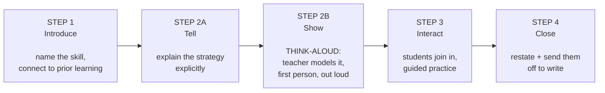

# 02 — Domain Primer: The Teaching Method

You cannot understand this system without this vocabulary. Every rule, every quality check and
every ranking decision is one of these ideas made mechanical. [Chapter 16](16-glossary.md) is the
full alphabetical reference; this chapter is the part you have to actually understand.

---

## 2.1 The four-step mini-lesson — the product's central object

A **mini-lesson** is a short, focused teaching script — roughly 10–15 minutes at the front of a
writing lesson. The client's method fixes its shape into four steps. In this system those steps
are **separate, individually-checked pieces**, not headings inside a blob of text.

*(Four steps, five pieces — Step 2 splits into Tell and Show.)*

### Where the weight sits

**Step 2B is the pedagogy.** It is the teacher thinking aloud in first person while actually doing
the thing — *"I close my eyes, I wonder…"* — so students hear the invisible mental work. The
client's single most-repeated complaint about early versions was that Steps 2A and 2B were too
thin.

The system enforces this **numerically**: Step 2A must be at least **twice** the length of Step 1,
and Step 2B at least **three times**. There is also a cap so that no single step may take more
than **55%** of the lesson. These are real thresholds in a real check, not guidance.

> A telling detail: the instruction given to the model asks for **four times**, while the check
> accepts **three**. That gap is deliberate — asking for more than you enforce leaves room for
> natural variation. An earlier version enforced four and was rejecting perfectly good lessons for
> young grades about a third of the time.

### Step 3's four exact phrases

Step 3 is not free prose. Four specific phrases must appear, and there must be genuine modelled
content after the last one:

1. *"help me with the next…"*
2. *"turn and talk"*
3. *"back to me"*
4. *"this is some of what…"*

All four are checked. **No paraphrase is accepted.**

> There is a second check on the last phrase: it finds the final occurrence of *"this is some of
> what"* and requires real content after it. That catches a lesson which satisfies the letter of
> the rule by ending *"…this is some of what."* with **no modelled teacher answer following**.

### The grade-band close

Step 4 must end with a specific phrase depending on the grade band:

| Grade band | Required closing |
|---|---|
| **K-2** | *"Let's go be writers!"* |
| **3-12** | *"Now it's your turn!"* |

Getting this wrong is a visible, immediate failure to the client — it was a live bug he caught
personally. It is one of the small set of behaviours the safety net guards permanently.

---

## 2.2 The vocabulary rules

These look like nitpicks. They are hard requirements with automated checks behind them.

| Rule | Why |
|---|---|
| **"details", not "reasons"** | The method deliberately teaches young writers to add *details*; "reasons" is a later, different concept. The rule is conditional — in opinion and persuasive writing at the youngest grades it is a **hard ban**, while older students actually composing a paragraph may legitimately use "reasons" |
| **"story" only for narrative** | Calling an informative or persuasive piece a "story" mislabels the mode. **Nuance:** the ban is on *mislabelling the piece*, not on the word — a metaphorical *"the story your data tells"* is fine, so on some paths this rule is deliberately left to the model's judgment rather than hard-blocked |
| **Never "activity"** | Writing is not an activity; it is instruction |
| **Never "discuss"** | Vague teacher-speak. The method's phrase is always *"turn and talk"* |
| **Never plug professional development** | The teacher is already a customer; don't upsell |
| **Always explain the strategy** | Naming a strategy without explaining it is useless to a teacher who doesn't own the books |

---

## 2.3 The taxonomies

### The writing modes — PIE

Writing is classified into three **modes**:

| Mode | Meaning |
|---|---|
| **P**ersuade | argument, opinion |
| **I**nform | explanatory, informational |
| **E**ntertain | narrative, story |

> ⚠️ **A real bug lived here.** The internal token for a mode once leaked into teacher-facing
> prose — *"For K-2 **persuade** writing…"*. The teacher-facing words are the **adjectives**:
> *Informative* / *Persuasive* / *Narrative*. The header reads `Grade 3 | Informative`, never
> `Mode: Inform`. The client rejected the latter explicitly, for "leaking an internal token and
> label".

**PIE** also names the client's **scope-and-sequence** — his ordered list of priority skills per
mode, per grade band. It is the backbone of unit planning, and the search layer deliberately
promotes it to the top when a teacher asks to plan a unit.

### The traits

The standard writing-trait framework: **Ideas, Organization, Voice, Word Choice, Sentence
Fluency, Conventions**. Every piece of source content is labelled with a trait, and teachers ask
trait-shaped questions.

### Grade bands

The client thinks in **bands**, not just individual grades: **K-2, 3-5, 6-8, 9-12** (plus "K-12"
and "all").

Bands are treated as **complete answers**, not as missing information — a lesson learned the hard
way, when a teacher who had just answered *"K-2"* was immediately asked again what grade they
taught.

---

## 2.4 The Launch books — and why "Launch first" is everything

Two books are the client's crown jewels: a **K-2** edition and a **3-12** edition of the same
flagship title. Between them they are the canonical source.

The client's number-one non-negotiable, in his words: **"Launch books first — always, always,
always."**

This is enforced **structurally**: content from those two books sits in a categorically higher
rank than course transcripts or reference material. It is **not** a score bonus that a
high-scoring other document could out-earn. An earlier scoring-only version was measured letting a
reference document outrank a Launch lesson — that measurement is why the categorical system
exists.

### The two halves of the book

The **first sections** of both books — roughly the first sixty pages — are **not writing skills**.
They are classroom **routines and management**: where writers sit, what goes in the folder, what
to do when you think you're finished.

The client distinguishes them with a neat rule of thumb:

> **"Writing is a skill. *Writer* is a procedure, or habit, or management."**

The system has a separate request type for this, with its own header — `Grade 3 | Management` —
and **no writing mode**, because a routine doesn't have one.

> ⚠️ **A cautionary detail.** Internal logic and a test both once asserted that management content
> lives in "sections 1–7". **No client document says that** — he says *"Sections 1–5"* / *"the
> first 60 pages"*. The boundary was invented by the team. (Confusingly, "Sections 1-7" *does*
> appear inside the client's own book, on its launch-planning page — so it wasn't fabricated from
> nothing, but it was never his instruction.) This is instance ~14 of the pattern in
> [Chapter 14](14-hard-won-lessons.md).

---

## 2.5 Named strategies

The methodology's teaching strategies have memorable nicknames, and **teachers use the nicknames,
not the concepts**:

- **pizza table** — a paragraph structure: the table-top is the topic sentence, the legs are the
  supporting detail sentences
- **Snapple details** — adding surprising factual details, like the trivia under a bottle cap
- **read-up / write-down** — a note-taking and paraphrasing routine
- …**46** of them in total

A teacher asks *"is there a pizza table lesson?"* and never uses the word "paragraph". The system
bridges that gap with a hand-built vocabulary: **46 canonical strategy names → 180 spoken synonyms
→ 243 related-skill keywords.**

> ⚠️ **Two things worth knowing early, both real bugs:**
>
> **1 · A strategy name is not a lesson.** *"Pizza table"* is attached to **14 different lessons**;
> 19 of 40 named strategies map to more than one. Asking *"which lesson does pizza table mean?"* is
> a malformed question — the right behaviour is to **explain the strategy**.
>
> **2 · Naming was being handled as a similarity problem instead of a lexical one.** For a long
> time the matcher compared only against the *descriptive* keywords — so the feature fired when a
> teacher **described** a skill and **never when they named it**, because the spoken nicknames sat
> in a field that was only ever produced as output and never matched against. Naming a lesson is a
> **fact**; it was being decided by a similarity score that never once crossed its threshold.

---

## 2.6 The nine kinds of question

Every incoming message is classified into exactly one of **nine request types**. This is the
single most important branch in the system.

| Request type | The teacher says… | What comes back |
|---|---|---|
| **Scripted mini-lesson** | *"Give me a mini-lesson on topic sentences, grade 3"* | The four-step script |
| **How to teach** | *"How do I teach persuasive writing?"* | A bulleted outline of discrete sub-skills |
| **Plan a unit** | *"Plan an informative unit for 5th grade"* | A numbered priority-skill list in teaching order |
| **Think-aloud** | *"Model a think-aloud for sensory details"* | First-person modelling prose |
| **Deepen the previous** | *"Go deeper on that same lesson"* | Inherits the prior lesson's facts, builds the next layer |
| **Correction** | *"Actually, make it 7th grade"* | Rebuilds the previous request — corrections **accumulate** |
| **Coaching** | *"My students hate revising — help"* | Grounded instructional advice in prose |
| **Management** | *"How do I set up my writing routines?"* | Routines overview from the books' first sections |
| **Meta** | *"Hi!"* / *"Can I get this as a PDF?"* / *"What's the weather?"* | A fixed canned reply — **no model call at all** |

Each has its own retrieval focus, output shape, header, and **client-approved closing question**.
The closers are verbatim client wording and are checked. See [Chapter 8](08-handlers.md).

---

## 2.7 Other terms you'll meet

| Term | Meaning |
|---|---|
| **Chunk** | One hand-crafted unit of source content — a complete lesson, a strategy explanation, a section overview — plus about 31 descriptive labels. **Never** an automated text split |
| **The lesson library** | 214 complete, ready-to-teach mini-lessons held separately from the main content store, each with book and page provenance |
| **Hand-written retrieval questions** | 1,254 realistic teacher questions, written by hand, indexed against 183 key lessons — the bridge between how teachers phrase problems and how the books phrase solutions |
| **The Protected Set** | The curated set of prompts and behaviours that must never regress |
| **Golden baseline** | A recorded snapshot of correct live answers, used to detect drift |
| **Non-negotiable** | One of the seven requirements the client marked as must-fix |
| **Wave** | A batch of work delivered in one working session, with a definition of done |
| **Writing level / stage** | For student subgroups, where a student is developmentally: *picture-drawing → labelling → words → sentences*. The assistant **asks** rather than assuming |

---

**Next:** [03 — The System at a Glance](03-system-overview.md)
