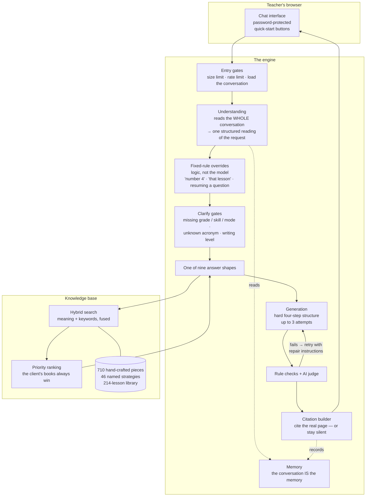
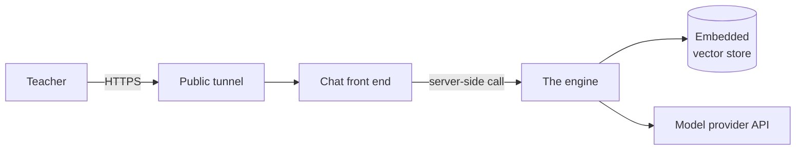

# 03 — The System at a Glance

---

## 3.1 Four generations, three of them deliberately replaced

The system you'll work on is the **fourth** build. The previous three were not abandoned through
drift or neglect — each was replaced because **measurement showed the foundation was wrong**.

| Gen | What it was | Why it was replaced |
|---|---|---|
| **1** | A managed cloud search product plus that vendor's language model | Managed search gave too little control over **which** document surfaced first — and that ordering *is* the client's number-one rule. Running costs and lock-in were also poor for a product that needs constant, fine-grained ranking work |
| **2** | A rebuilt stack: a different model provider plus a self-hosted hybrid search engine | Superseded during the retrieval rebuild |
| **3** | Same stack, with conversation state held in a **mutable session record** updated by rules each turn | Memory was buggy in a way that could not be patched: the rules layer drifted from what the conversation actually said. Replaced by re-deriving state from the conversation on every turn |
| **4** | **Current.** "The conversation *is* the memory" | Live |

That pattern — **build, measure against the methodology, and rebuild rather than patch when the
measurement says the foundation is wrong** — is the project's defining habit. It is the expensive
way to build software. It is also the only way this product reached the fidelity it has.

---

## 3.2 The component map

### What each part is responsible for

| Part | Owns |
|---|---|
| **Entry gates** | Message size, per-user rate limiting, loading the conversation so far |
| **Understanding** | Turning a messy sentence plus the whole conversation into one typed decision |
| **Fixed-rule overrides** | The handful of questions that are **arithmetic, not judgment** — and are therefore taken away from the model |
| **Clarify gates** | Asking **one precise question** instead of guessing, and remembering what was asked |
| **Answer shapes** | Nine of them — each owning one kind of response, its layout, its header, its closing question |
| **Retrieval** | Finding the handful of source passages the answer must be built from, in the right priority order |
| **Generation** | Writing into a required structure, with the depth in the right place |
| **Rule checks + judge** | Enforcing the client's rules mechanically; sending failures back with repair instructions |
| **Citation builder** | Naming the real book and page — or saying nothing at all |
| **Memory** | An append-only record of the conversation, re-read in full every turn |

---

## 3.3 The technology, and why

| Layer | Choice | Why it's that |
|---|---|---|
| **Web service** | A Python async web framework | Standard, typed request/response contracts, good streaming and concurrency story |
| **Search** | A **locally embedded** vector database — a folder on disk, not a server | Total control over ranking, no per-query vendor cost, no network hop. The trade-off is real and appears again in Chapter 12: **only one process may use it at a time** |
| **Meaning search** | Dense embeddings, 3,072 dimensions | Finds content that *means* the same thing when the wording differs |
| **Keyword search** | A classic keyword-ranking algorithm | Finds exact terms — strategy nicknames, proper nouns — that embeddings blur |
| **Fusion** | Reciprocal-rank fusion of the two result lists | Rank-based rather than score-based, so the two very different scoring scales never need to be reconciled |
| **Generation** | A flagship large language model | Writes the teaching prose |
| **Understanding + judging** | A cheaper sibling model | These two passes run on **every** turn; putting them on the flagship model tripled the per-turn cost for no measured quality gain |
| **Session storage** | **In process memory**, capped | Deliberate for a pilot. Durable storage is a known, scoped, unbuilt item |
| **Front end** | A lightweight Python web-app framework | It is an **evaluation surface for the client**, not the final product — the final destination is an embed inside the client's own course |

> **One historical note worth carrying:** a newer, more advanced generation model was tested and
> **rejected**. It refuses to run at zero randomness, and the resulting variance made outputs
> *worse* for a task whose whole value is consistency. Newer is not automatically better when the
> requirement is fidelity.

---

## 3.4 The shape of a deployment

One machine. Three long-running processes:

The teacher's browser **never talks to the engine directly** — the front end calls it
server-side. That is why the engine can stay bound to the local machine only.

No containers, no load balancer, no continuous deployment, no staging environment. Several
operational constraints in Chapter 12 are direct consequences of that.

---

## 3.5 Roughly how big it is

| | |
|---|---|
| Application logic | ~17,600 lines |
| **Automated checks and verification harnesses** | **~33,000 lines** |
| Fast automated checks | **2,092**, running in under 10 seconds |
| Hand-crafted knowledge base | 710 pieces of content across 42 source documents |
| Ready-to-teach lesson library | 214 lessons |

> **That ratio — verification larger than the product — is not an accident, and it is not
> gold-plating.** Chapter 14 explains exactly what it is defending against.

---

## 3.6 Where the complexity actually lives

If you expect the difficulty to be in the search or the model, you'll be surprised. Measured by
size and by defect history, the hard parts are:

1. **The answer shapes** — nine kinds of response, each with its own layout, header and exact
   closing question, plus the rules that must be shared between them.
2. **The priority ranking** — making "the client's books first" a guarantee rather than a
   preference, without breaking the cases where a different source genuinely belongs on top.
3. **The understanding pass** — including the small set of decisions deliberately **taken away**
   from the model.
4. **Delivery** — making sure a rule that is correctly implemented actually reaches the teacher.
   This sounds trivial. It is the single most common way this project has shipped a defect.

---

**Next:** [04 — Life of a Request](04-request-lifecycle.md)
