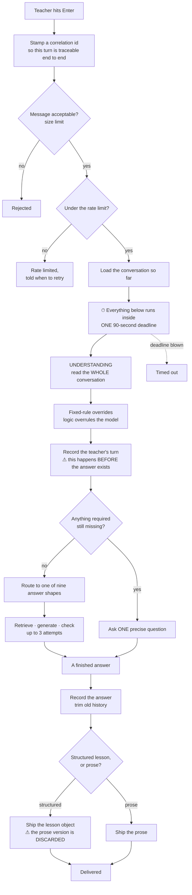

# 04 — Life of a Request

This is the spine of the system. Everything else in this handbook hangs off it.

The teacher-facing surface is tiny: **one operation.** A message goes in; an answer comes out.
(There are a couple of health probes alongside it, and nothing else.)

---

## 4.1 The whole journey at a glance

---

## 4.2 Stage by stage

### 1 · Correlation id

Every turn is stamped with a unique id at the very outside edge, before anything else runs. It
flows through every log line the turn produces — including the access log — and is shown back to
the teacher in the interface. **A bug report can therefore be traced to exactly one conversation
turn in the logs.** A small piece of design that pays for itself constantly.

An inbound id is accepted only if it has the right shape; otherwise a fresh one is minted. That
check exists to stop anyone poisoning the logs with a forged value.

### 2 · Size and rate limits

| Limit | Value |
|---|---|
| Message length | ~2,000 characters |
| Requests per user | **50 per hour**, sliding window |

> ⚠️ **Three real problems here, all worth knowing:**
>
> 1. The rate-limit key is **supplied by the caller**, so changing it resets your quota.
> 2. The front end sends **the same constant for every user** — so the entire public deployment
>    shares **one 50-per-hour bucket**. One person can lock everyone out.
> 3. In a test sweep, an unvaried identity produced **54 rate-limit rejections** that were
>    initially read as **28 behavioural regressions**. Always vary the identity when driving
>    automated conversations.

### 3 · Load the conversation

The conversation is returned **by reference, not as a copy**. Remember that — it causes stage 5's
trap.

### 4 · The deadline

Everything from here to delivery runs inside a single **90-second** budget.

> The arithmetic is deliberately uncomfortable: three generation attempts, each of which may make
> several underlying calls with their own timeouts, can easily exceed 90 seconds.
> **The deadline is the backstop, not the plan.**

### 5 · Understanding, then the overrides

A fast model reads the **entire conversation** at zero randomness and produces one typed reading
of the request. Then **fixed logic gets to overrule it** on the handful of questions that are
facts rather than judgment — see [Chapter 5](05-query-understanding.md).

Immediately after, the teacher's turn is appended to the conversation.

> ⚠️ **The orphan-turn trap.** The teacher's turn is recorded *before the answer exists*, and it
> mutates the stored conversation in place. If the answer then fails or times out, the save step
> is never reached — **but the mutation already happened.**
>
> Driven directly: a failure, then a timeout, then a success leaves the stored conversation
> holding **three consecutive teacher turns** followed by one answer. The next turn's
> understanding pass reads that as though each question had been asked *and answered*.
>
> **Every retry after a timeout silently corrupts the conversation the model reads.**

### 6 · The clarify gate

Before any answer is attempted: if the request can't be fulfilled without a missing fact — a
lesson with no grade, a unit plan with no mode, an unrecognised acronym — the system **asks one
precise question** in client-approved wording, and **remembers what it asked**, so the teacher's
next answer resumes seamlessly.

No model call happens on this path at all.

### 7 · The answer

Retrieve → build the instruction → generate → check → retry on failure, up to **three attempts**.
Covered in Chapters 7 through 9.

### 8 · Record and deliver

The answer is recorded — **both** its prose form and its structured form, along with any list it
offered and any question it left open — and old history is trimmed.

---

## 4.3 ⚠️ The delivery switch — read this twice

This is the single most consequential contract in the system, and the source of more shipped
defects than anything else.

**An answer can leave the engine in one of two forms:** a **structured lesson object**, or **plain
prose**.

> **Whichever one is present decides what the teacher receives — and when the structured form is
> set, the prose version is discarded entirely rather than merged.**

Three consequences follow, and none of them is obvious:

1. Any transformation applied **only to the prose form** on a lesson is **invisible to the
   teacher**.
2. The answer is simultaneously **relabelled as a lesson**, and the interface branches on that
   label to choose its renderer.
3. Therefore **attaching a stray value to the structured form on a path that returns prose would
   replace the teacher's answer with a raw data blob.**

This was verified directly rather than reasoned about: a deliberately-instrumented response
carrying both a human answer and a token structured value shipped **the structured value** — and
the human answer was gone.

### The incidents this caused

| Incident | What happened |
|---|---|
| **A title-capitalisation rule** | Written against the prose form only. The structured branch predated it by two and a half months, so the feature **never worked for a single day** — while its automated checks stayed green, because they scored the helper in isolation |
| **A post-lesson follow-up question** | Never reached the payload, same cause |
| **A one-skill warning note** | Attached to the prose only — pure decoration, until it was *also* written into the structured form |
| **A near-outage** | A proposed fix said *"attach the offered list to the structured form."* On a prose path, that would have shipped every teacher **a raw data blob instead of their unit plan** |

That last one is why the offered list is a **first-class part of the answer contract**, not a key
smuggled inside the structured form.

### The rules that follow

1. **Never set the structured form on a path that ships prose.** Only the mini-lesson path may.
2. **Never use the structured form as a side channel for a flag.** Add a proper field to the
   answer contract instead.
3. **Any deterministic transformation of a lesson goes in exactly one place** — a single delivery
   seam that every exit from the lesson path funnels through.
4. **Verify at the delivery boundary.** A check that inspects the prose form proves **nothing**
   about what the teacher sees.

### Two live consequences

- The recorded turn keeps **both** forms. So the conversation history that the understanding pass
  reads as memory contains a prose version **the teacher never saw**. A divergence between the two
  is invisible in the transcript.
- There is a dormant path that would return a structured lesson with **no step content at all** —
  and the interface skips empty steps. If it ever fired, the teacher would receive a title, a
  caption, and **no lesson**. It is believed unreachable in practice (it requires a similarity
  score that has been measured firing zero times), but the path is live.

---

## 4.4 What comes back

Alongside the answer itself, each response carries diagnostics: the request type, a quality label,
the sources used, the assembled source material, a judge score, a structured reading of the
question, a snapshot of session memory, and the correlation id.

**Fields that look real and are not** — worth knowing before you build anything on them:

| Field | Reality |
|---|---|
| "Ungrounded terms" | Always empty — hardcoded |
| "Follow-up question" | Declared, never filled. Always null |
| Each source's relevance score | **Hardcoded to zero** |
| Each source's content type | **Hardcoded to blank** |
| "Query specificity" | **Hardcoded** to a single value |
| Three "pending" memory slots | Read from a mechanism that is **never populated** — permanently null |
| Two of the five quality labels | Documented, but **unreachable** |

> ⚠️ **The page number never reaches the caller.** Internally every source reference carries its
> page — but the outbound shape has no page field, so it is silently dropped. Any tool trying to
> answer *"which page did this come from?"* from the response's source list **cannot**.

---

## 4.5 Failure handling

The mapping is deliberate rather than default:

| Situation | Result | Note |
|---|---|---|
| Malformed request | Rejected as a client error | Not the framework's default code — chosen deliberately |
| Any timeout | Gateway timeout | |
| **Bad model-provider credentials** | **Internal error, logged loudly** | Deliberate: a bad key is an *operator* bug, not a transient one. Reporting it as a temporary upstream failure would invite pointless client retries |
| Other upstream failures — **including the provider's own rate limiting** | Upstream failure | So an *upstream* rate limit surfaces differently from *our own* |
| Anything unexpected | Internal error | **Full detail to the logs, never to the caller** |

> Two rate-limit events therefore look different from outside: **ours** says "rate limited" and
> tells you when to retry; **the provider's** reports as an upstream failure. Knowing which you're
> looking at matters when debugging.

---

## 4.6 Logging

One output stream. Secrets are redacted — and **in three separate places, not one.**

> The reason is subtle and worth internalising: a log filter runs **before** the formatter renders
> an exception into text. So the filter alone would let a secret inside a stack trace reach the
> output. Both formatters therefore redact as well — and **all three call the same single
> redaction function**, so they cannot drift apart.

Three patterns are redacted: provider-style API keys, bearer tokens, and web tokens.

> ⚠️ **The teacher's message reaches the logs when a request is rejected as malformed** — the
> validation error embeds the offending input verbatim. A 2,001-character message was written to
> the log in full. It is only redacted if it happens to match one of the three secret patterns.

---

## 4.7 Health

Two kinds of health check, and the distinction matters:

| Kind | Meaning |
|---|---|
| **Liveness** | Is the process alive? Touches nothing. Failure means *restart me* |
| **Readiness** | Can it actually serve? Reports **degraded** so a load balancer removes the instance **without restarting it** |

Readiness runs three probes **in parallel**, so latency is the slowest one rather than the sum:
the vector store is reachable, the lesson library is non-empty (**empty counts as a failure** — an
empty library degrades the product silently), and the model provider answers.

Results are cached briefly — **successes only**, so recovery is immediate rather than delayed.

> ⚠️ **Readiness costs money**: every uncached check makes a real call to the model provider.
> Don't point an aggressive uptime monitor at it, and don't shorten the cache casually.

---

## 4.8 Configuration traps

- **Five settings are dead knobs** with no effect whatsoever — including the number of generation
  attempts and the generation randomness. The real values are fixed in the logic. Changing the
  settings changes nothing.
- **An empty value for the model provider's base address poisons the client library** — it honours
  an empty string as a real address and fails on the first call. There is a defensive scrub for
  exactly this.
- **A stale credential in the surrounding environment silently overrides the configured one.**
- **Configuration paths are relative to where the process is started**, which fails in two
  different ways. See [Chapter 12](12-running-and-ops.md).

---

## 4.9 One more thing: there is no authentication

There is **no authentication on the engine at all.** No token check, no identity, no gate.

The only protection in the whole system is a **single shared password on the front end**, which
protects the interface, not the engine.

Today the engine is safe because it binds to the local machine and only the front end is exposed.
**That is a network accident, not a control.** A signed-token design is reserved for the future
but is not implemented — and the configuration placeholder for it does nothing.

---

## 4.10 Check yourself

1. An answer is produced carrying both a human sentence and a stray structured value. What does
   the teacher see? Where should that value have gone instead?
2. A request times out at 90 seconds and the teacher immediately retypes it. What is now in the
   stored conversation — and why does the save step never running fail to prevent it?
3. The model provider rate-limits us mid-generation. How does that look to the caller, and how
   does it differ from *our* limiter tripping?
4. You change the "maximum generation attempts" setting. What happens?

---

**Next:** [05 — Understanding the Question](05-query-understanding.md)
