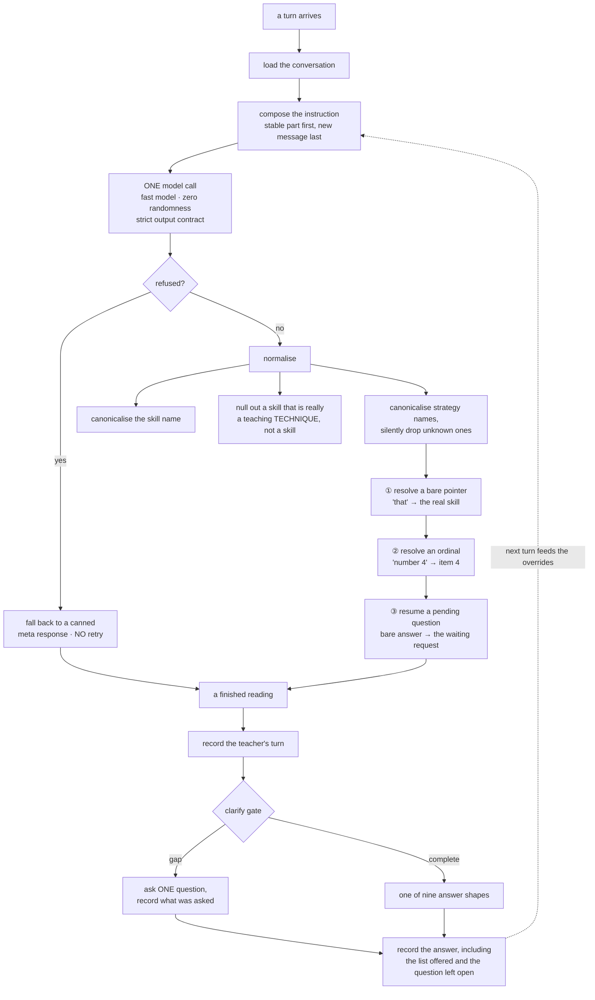

# 05 — Understanding the Question

One pass runs before anything else, on every turn. One model call in, one typed reading out.

**Why it's architecturally central:** everything downstream — which kind of answer runs, what gets
retrieved, what the model is instructed to do, whether the system asks a question instead of
answering — is derived from that one reading and **nothing else**. There is no state machine, no
rules layer, no accumulated ledger.

> **The conversation is the memory, and this pass is the only thing that reads it.**

---

## 5.1 What goes in

The understanding pass receives the **entire stored conversation** — not a window, not a summary.
There is no truncation; it walks every turn.

The only bound is applied elsewhere, when the conversation is saved: **120 turns or 240,000
characters**, whichever trips first (see [Chapter 6](06-session-memory.md)).

Two details that matter:

- **The new message is not yet part of the conversation.** It arrives separately, and the
  teacher's turn is only appended *after* this pass returns. So the turn numbering this pass sees
  is one behind what the answer logic sees.
- **Nothing is compressed.** A session containing three full mini-lessons puts all three in
  verbatim. Budget accordingly when reasoning about cost or latency.

The instruction is laid out **stable-first, fresh-last**, so the unchanging part can be cached by
the provider between turns. What it contains:

```
=== CONVERSATION HISTORY ===
[Turn 0] TEACHER
   How do I teach paragraphing?
[Turn 1] ASSISTANT
   … the full text …
[Turn 1 — the list this turn offered] ["Teach students to…", "Teach students to…", …]
[Turn 1 — summary of the lesson delivered] { skill, grade, mode, trait, strategy, page }

=== NEW MESSAGE ===
   number 4

=== INSTRUCTION ===
   (the current turn number; inherit grade and skill from earlier turns)
```

> Notice what the assistant's turns carry back in: **the numbered list they actually rendered**,
> and a short summary of any lesson delivered. Those two lines are what make cross-turn memory
> work at all.

---

## 5.2 What comes out

One typed reading, produced under a **strict output contract** so the model physically cannot emit
an invalid value.

### The routing decision

| Field | Meaning |
|---|---|
| **Request type** | Which of the **nine** kinds of answer this is. Required |

### The pedagogical facts — each carrying provenance

| Field | Carries |
|---|---|
| **Grade** | The value · whether it was stated explicitly · **which turn it was stated on** · a confidence |
| **Mode** | Persuade / Inform / Entertain — or *"all"*, which means **mode-agnostic**, not a mode |
| **Trait** | One of the writing traits, or "all" |
| **Skill** | **Dual representation** — see below |

> **Recording *which turn* a fact was stated on is why the assistant never re-asks.** "The teacher
> already told us the grade three turns ago" is a **fact in the reading**, not an inference
> someone has to make later.

**The skill is deliberately held in two forms, and this is load-bearing:**

- a **canonical** name — normalised, used for searching and for cross-turn consistency
- the teacher's **literal words** — rendered back to them as the lesson's focus

That split exists because of a specific client complaint: he typed *"topic sentence and supporting
details"* and the assistant answered about *"distinguish between details and development"* — a
silent rename. **The canonical name may be used to search; the teacher's own words are what they
must see.**

### The signals

| Signal | Fires when |
|---|---|
| **Extra skills** | The teacher crammed a **second co-equal skill** into one lesson |
| **Unknown acronym** | An **unrecognised** student-group acronym appeared |
| **Subgroup** | A **recognised** one appeared |
| **Writing level** | A developmental stage was mentioned — picture / label / word / sentence |
| **Frustration** | The teacher voiced frustration. Orthogonal to the request type |
| **Refers to the previous turn** | This message points backwards |
| **Named strategies** | Strategy nicknames the teacher explicitly used |
| **Missing information** | Facts the pass **observed** as unstated |

> **"Missing information" is an observation, not a decision.** A separate layer decides whether
> any of it is worth interrupting the teacher over. That separation matters, and Chapter 8 covers
> the policy side.

### ⚠️ Five signals with no consumer

Verified by exhaustive search: five of the fields produced by this pass are **read by nothing that
acts on them** — merely passed through and displayed in a diagnostics panel.

The instruction spends real tokens teaching the model to compute all five. Worse, the
documentation for one of them **describes behaviour that does not exist**.

> This is the same "inert field" shape that already burned this project once.
> **Treat any claim about these five with suspicion until you find what consumes them.**
> See [Chapter 14](14-hard-won-lessons.md).

---

## 5.3 The pipeline



**Exactly one model call. No retry.** A refusal degrades to a canned response. Anything else
propagates to the deadline.

---

## 5.4 The three overrides — the heart of this stage

After the model answers, **logic gets to overrule it** on three questions. Each override exists
because the model demonstrably got that question wrong in production.

The dividing principle:

> **An ordinal is arithmetic. A name is judgment.**

### ① "that" → the real skill

**Runs first**, so the ordinal result is final and never re-examined as a pointer.

If the teacher's stated skill is a bare pointer, replace it with what it points at. If no
non-pointer referent exists, **leave everything unchanged** — it never invents a skill from a
pointer.

**What counts as a pointer:** a bare demonstrative on its own, **or** a phrase of **two to four
words** starting with one that doesn't resolve to a known skill.

> The four-word cap is the bound that stops the resolver clobbering a real skill. Without it,
> *"Those transition words matter for readers"* was silently rewritten to the previous lesson's
> skill. A phrase that merely *contains* a demonstrative — *"Transitions between those
> paragraphs"* — is **not** a pointer; it must lead with it.

**Referent priority:** the lesson currently on screen → the last skill the teacher stated → this
turn's own canonical name → give up.

**Why this is logic and not the model:** on a *"give me more on that"* follow-up, the model
sometimes writes the bare pronoun into the teacher's-words field while the canonical name stays
correct. That field is rendered **verbatim as the lesson title and into Step 1** — producing
**"Today we're going to focus on that."**

And the vocabulary check **certified it**, because *"that"* does appear in *"that"*.

> **A green check that can never fail is worse than no check.** That sentence is this project in
> miniature.

### ② "number 4" → item 4

If the message names exactly **one in-range position** in the list the *most recent* answer
actually rendered, replace the skill with that item. Otherwise leave the model's answer completely
alone.

Two recognised forms, both requiring an **anchor**:

| Form | Examples | Why the anchor is required |
|---|---|---|
| Anchored number | *number 4*, *no. 4*, *#2*, *option 3*, *item 5* | A bare "4th" is far more often a **grade** |
| "the Nth one" | *the third one*, *the fourth lesson* | The trailing noun stops *"my second graders"* reaching it |

Measured behaviour:

| Message | Result |
|---|---|
| *number 4* | item 4 |
| *the third one* | item 3 |
| *#3* | item 3 |
| *4th grade* | **not ours** — left to the model |
| *item 9* (out of range) | **not ours** |
| *number 2 and number 3* | **not ours** — two positions |
| *"Snapple details"* | **not ours** — a **name** is judgment |

It reads the list from the **most recent answer only** — deliberately not a backwards scan,
because scavenging history is what once let the assistant re-surface a list from several turns ago
under the words *"the list I just shared."*

**Why this is logic and not the model:** asked for *"number 4"*, the assistant confidently shipped
**item 3** — correctly titled, correctly formatted, with no signal anything was wrong. An
identical input on another run got it right.

> **That is a coin flip, and a wrong lesson is worse than silence.**

### ③ A bare answer resumes the pending question

**Runs last**, and changes **only the request type** — so it can neither disturb nor be disturbed
by the other two.

When the previous answer was an open clarifying question and the teacher's reply is a bare field
answer, route it back to the request that was waiting.

**Three conditions, all required:**

1. **Six words or fewer**
2. **No new-request marker** — no question mark, no question word, no *"actually"* / *"instead"*,
   no *"give me"* / *"show me"*, no *"can you"*, no *"I need"*
3. **It actually supplies one of the missing facts** — a parseable grade, a mode adjective, or a
   recognisable skill

Measured:

| Reply | Resumes? |
|---|---|
| *8th grade* · *I teach 8th grade* | ✅ |
| *topic sentences* · *K-2* · *persuasive* | ✅ |
| *what grade?* | ❌ contains a marker |
| *actually 4th grade* | ❌ marker |
| *give me a lesson on transitions* | ❌ marker |
| *using strong verbs* | ❌ unrecognised skill — **deliberate**: silence is cheap, a wrong route is a lie |
| *ok* / *sure* / *yes* | ❌ supplies nothing |

> The marker list is built from **phrases and question words rather than bare verbs**, because the
> clarifying question itself contains *"teach"* — *"What grade level do you teach?"* — and the most
> natural real answer echoes it: *"I teach 8th grade."*

The mode vocabulary here is **derived from the same table the rest of the system uses** rather
than re-typed, so the answer vocabulary cannot drift.

**Why this is logic and not the model:** a bare *"8th grade"* gets re-classified **from scratch**,
and a rule in the instruction makes *coaching* the catch-all for terse follow-ups. Coaching
requires neither grade nor skill, so the clarify gate never re-runs — and the teacher gets coaching
prose that **invents a skill** instead of the lesson they were being asked to specify.

The classification sat on a knife's edge: the same input routed one way through the live system
and the other way **63 times out of 63** through a direct call. **No prompt tweak could fix that.**

> Note the asymmetry that makes the override safe: a false negative leaves the status quo; a false
> positive merely re-asks the same question, which is honest.

---

## 5.5 Normalisation

Before the overrides, three normalising passes run — and one of them is more interesting than it
sounds.

| Pass | What it does |
|---|---|
| Canonicalise the skill | Map what the teacher said onto the system's standard name — **never returns nothing**, falling back to the cleaned input |
| **Null out a technique masquerading as a skill** | Terms like *"think-aloud"*, *"mini-lesson"*, *"writer's workshop"* are **teaching techniques, not writing skills**. If the skill resolves to one, it is discarded so the answer inherits the real skill from the previous turn. Without this, *"give me a think-aloud"* would produce a lesson **about think-alouds** |
| Canonicalise named strategies | Unknown ones are **silently dropped** |

Grade parsing, measured:

```
3rd graders → 3       kinder → K          grade 11 → 11
primary → K-2         little ones → K-2   secondary → 9-12
my older kids → (nothing)                 3rd grade band → (nothing)
```

**Bands are checked before individual grades**, so *"middle school"* wins over a stray ordinal in
the same sentence. And a hard disqualifier refuses any phrasing containing *"grade band"* — killing
an old hallucination at the source.

---

## 5.6 Grades and bands

- **One flat vocabulary, no separate band type.** Nineteen values: the individual grades, the four
  bands, plus "K-12" and "all". There is no *is-a-band* flag anywhere.
- **A band is a complete answer.** The clarify layer drops grade from the ask-list whenever a
  grade is present *at all*, band included. That fixed a real bug: the assistant re-asked *"What
  grade level do you teach?"* of a teacher who had just answered *"K-2."*
- **Downstream, a band collapses to a two-way choice** for the closing line: the youngest band on
  one side, **everything else — including unknown — on the other.**
- **In the header, the value renders literally**: a K-2 informative lesson is headed
  `Grade K-2 | Informative`.

---

## 5.7 Gotchas

1. **The instruction's list of named strategies is 13 short of the actual data** — it names 33
   where the data holds 46, while a comment claims they're in sync. The model generally won't
   produce those 13 because it was never told they exist.
2. **Unrecognised strategies are dropped silently.** Combined with (1), a strategy the teacher
   named can vanish without a trace at normal logging levels.
3. **The documentation claims a grade-normalisation step that does not exist.** Grade needs none —
   the strict output contract handles it.
4. **The instruction tells the model to flag a grade *band* as missing; the clarify layer throws
   that away.** Both are live and they contradict each other. **The logic wins.** A recorded test
   case still encodes the instruction's version. If you change one side, change all three.
5. **"The second one" parses as a bare *grade* answer** (word-ordinal "second" → grade 2).
   Currently harmless, because override ② runs first and ③ only changes the request type — but if
   ③ is ever widened to write facts, this is where it bites.
6. 🔴 **An entire "pending handshake" mechanism is completely dead** — several types, a rendering
   function, and a whole section of the instruction that can never appear, because nothing ever
   populates it. **Do not fix a bug by putting something into it; nothing will read it.** The
   feature that *replaced* it records the pending question on the turn itself.
7. **Normalisation fails silently.** Missing vocabulary files log a warning and yield empty maps —
   so a missing file quietly disables the technique-versus-skill guard entirely.
8. **Hyphens are not stripped during normalisation.** *"pizza-table"* and *"pizza table"* are
   distinct lookup keys, both mapped explicitly. Don't "simplify" this.
9. **The live verification of this pass is deliberately lenient** — some fields are only checked
   when a recorded case expects a positive value, and lists are checked for containment rather than
   equality. Which means a case expecting a *negative* value **cannot fail on that field**. Know
   what your check cannot catch.

---

## 5.8 The recorded cases

There are **26 recorded conversations** used to verify this pass: 18 replaying the client's own
annotated sample chat turn by turn, and 8 edge cases. Two consumers — a fast offline check that the
recorded set is well-formed and internally consistent, and a paid live check that runs all 26
against the real model, deliberately gated off by default so routine verification never spends
money.

---

## 5.9 Check yourself

1. The previous answer offered a numbered list of five sub-skills, and the teacher types *"give me
   a lesson on number 4."* Trace every place the digit is consulted, and explain why the model's own
   answer is discarded. What if they'd said *"number 4 or maybe number 2"*?
2. The assistant asks for a grade; the teacher replies *"I teach 8th grade."* Walk the three
   conditions. Which single part of the reading may be changed? What did the teacher get **before**
   this override existed, and why couldn't a better instruction have fixed it?
3. The reading comes back with the canonical skill correct but the teacher's-words field set to
   *"that"*. Which override fires, where does it look for a referent, and **what would Step 1 have
   said without it — and why would the vocabulary check have passed it?**
4. You want to add a new signal to the reading. List everything that must change for it to affect a
   teacher — and name the **two failure modes this stage has already shipped** that your checklist
   must rule out.

---

**Next:** [06 — Memory](06-session-memory.md)
