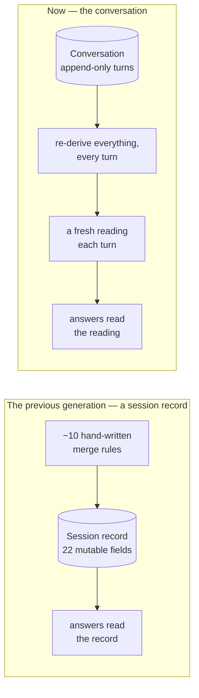
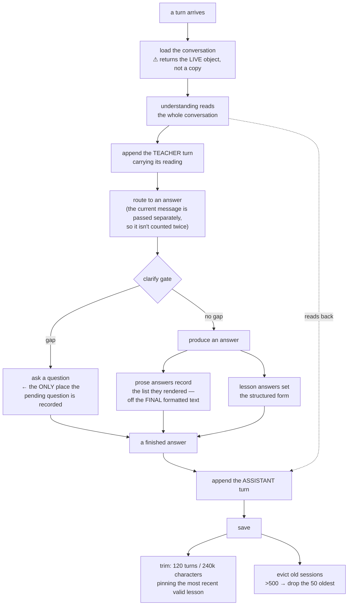

# 06 — Memory

This is the design choice that most distinguishes the current system from what came before, and
the one most likely to surprise you if you've built conversational systems before.

---

## 6.1 The idea

Most conversational systems keep a **mutable state object** — a session record — updated by rules
each turn: *"the teacher said grade 4, so write grade = 4 into the record."*

This system deletes that entirely. There is exactly one place memory lives: **an append-only list
of turns.** Every turn, the understanding pass reads the whole list and re-derives the state from
scratch.

> From the system's own internal documentation: *the conversation is the source of truth, and a
> fact only earns a place outside it if it genuinely cannot be derived from the visible turns.*

### Why the session record was replaced

The evidence is in the old system's own internal notes, not in a design document:

> *"Typos pass silently. Asking the record for a misspelled field returns nothing; the logic
> branches to 'no active skill' and forgets the teacher's input."*
>
> *"Invariants live in prose — grade is first-wins, mode is latest-wins-with-a-confidence-gate,
> the offered list is append-only. These rules lived only in comments."*

**Twenty-two fields maintained by about ten hand-written merge rules, with the invariants
documented in comments.** It drifted, and the drift was invisible.

### ⚠️ The honest caveat

**Deleting the record deleted things that turned out to matter.**

The old record **had** a field remembering the list last offered to the teacher. The rebuild
dropped it to a declared-but-never-written field — and had to **re-earn it three months later**.
The same story repeated for the pending-question signal: the new system shipped a *type* for it
and never wired it up, so a later change had to record that on the turn itself instead.

So the accurate summary is:

> **The conversation replaced the derivable 80% of the session record. The non-derivable remainder
> had to be added back, one field at a time, each with a test at the delivery boundary.**

---

## 6.2 What a turn holds

| | Meaning |
|---|---|
| **Position** | Enforced — appending out of order is an error |
| **Who spoke** | Teacher or assistant |
| **The text** | The flattened, model-visible rendering |
| **The structured form** | Present only for lessons |
| **The list this turn offered** | Assistant turns only — **so "number 4" can be resolved next turn** |
| **The question this turn left open** | Assistant turns only — **which request was waiting on an answer** |
| **Sources used** | Which content informed it |
| **The reading** | Teacher turns only — what the understanding pass extracted |
| **Quality** | Valid, low, or failed |
| **Timestamp** | |

> ⚠️ **Turns are not immutable**, despite an internal comment claiming otherwise. Every field can
> be reassigned. Nothing structurally prevents a future change from rewriting a stored turn's text.

---

## 6.3 The write path

**What the recorded answer does *not* keep:** retry counts, the list of rule violations, judge
scores, the assembled source material. Those are diagnostics for that response only, and vanish
with the turn.

---

## 6.4 Storage, eviction, trimming

| Property | Reality |
|---|---|
| Backing store | **Plain in-process memory.** No database, no cache server, no disk |
| Session cap | **500**, evicting **50** at a time, least-recently-used first |
| Expiry | **None.** A session survives until pushed out by 500 newer ones, or the process restarts |
| History cap | **120 turns or 240,000 characters**, whichever trips first |
| Concurrency | **Single-process assumption.** No locking — each request runs on one thread of one process |

Measured: 500 sessions stay at 500; the 501st drops it to **451**. And 200 appended turns trim to
**exactly 120**.

### Trimming is careful, and soft

- Turns are dropped **in pairs** — never an orphaned question without its answer.
- **The most recent valid lesson, and the message that asked for it, are pinned** — so *"go
  deeper"* stays reliable even in a very long session.
- Positions are **renumbered afterwards**, preserving the ordering invariant.
- If everything remaining is pinned, it **stops quietly**. The caps are a soft limit, not a
  guarantee.
- The character budget counts only the text, not the structured forms — so real size can exceed
  the estimate.

### What is lost on restart

**Everything.** Conversations, pending state, eviction order, and the rate-limit window.

> ⚠️ **And the teacher is never told.** The browser keeps its session identity, so after a restart
> it keeps sending the same one and the engine silently creates a brand-new empty conversation.
> **The teacher watches the assistant "forget" mid-chat, with no error.**

---

## 6.5 The facts that carry across turns

This table is the practical core of the chapter.

| What | Written by | Read by | What breaks without it |
|---|---|---|---|
| **The list a turn offered** | the answer builder → the delivery boundary | the ordinal resolver · the understanding instruction · the re-ask that shows the list again | *"number 4"* is resolved by the model counting markdown → **silently ships the wrong skill** |
| **The question a turn left open** | one single place → the delivery boundary | the resume override | a bare *"8th grade"* is re-classified as coaching, which skips the clarify gate and **invents a skill** |
| **Locked grade / skill / mode** | **not stored** — re-derived every turn, with provenance | the deepen-the-previous merge · the correction fold · the diagnostics panel | the assistant **re-asks a grade the teacher already gave** — the client's original complaint |
| **A carried graphic organizer** | **not stored** — derived from the previous answer's text | threaded into a follow-up lesson | *"give me a mini-lesson for that"* invents a *different* organizer instead of using the one just described |
| **The structured lesson form** | the lesson path only | finding the most recent lesson · pinning during trims · resolving *"that"* · the understanding summary | *"go deeper"* loses its target; trimming stops protecting the last lesson |
| **Quality** | the delivery boundary | pinning · prior-context lookup · the understanding instruction | a poor-quality lesson gets inherited as though it were canonical |

**Two of those are not stored at all** — they're re-derived. That is the design working as
intended.

---

## 6.6 ⚠️ The inert-field trap — the most instructive bug here

Before it was fixed, the offered list was:

- **read** by the understanding pass,
- **named** in the instruction given to the model,
- and **written by nobody except a test fixture and a sample.**

A check hand-wrote the value and asserted the renderer forwarded it. **Green forever.** Production
sent nothing.

The consequence: *"give me a lesson on number 4"* was resolved by the model counting items in
markdown, and it shipped **item 3** — under a confident, correctly-titled lesson, with no signal
that anything had gone wrong.

### How it is wired now — writer *and* reader, both in production

| Role | Where |
|---|---|
| Writer 1 | The answer builder, reading the **final formatted text** the teacher will actually see |
| Writer 2 | The delivery boundary, onto the recorded turn |
| Reader 1 | The deterministic ordinal resolver |
| Reader 2 | The understanding instruction |
| Reader 3 | Re-showing the list when the teacher's follow-up is ambiguous |
| Guard | The understanding pass **deliberately refuses** to honour the value if it appears in the wrong place — **one home for the data** |

> **The check that would have caught the original bug failed on its very first run** — the delivery
> boundary was dropping the field.

### The distinction to internalise

> **A field that exists proves nothing. Only a check that reads it back from the *other side* of
> the delivery boundary proves it is delivered.**

### And the proposed fix would have caused an outage

The obvious-looking fix — *"attach the offered list to the structured form"* — would have set the
structured form on a **prose** answer, and the delivery switch would have shipped a raw data blob
instead of the teacher's unit plan.

---

## 6.7 The mirror trap: an entire dead mechanism

There is a whole subsystem for *"the assistant promised something and is waiting on a yes or no"*
— several types, a container, helper methods, a rendering function, and a dedicated section of the
model instruction.

**Nothing writes it. Nothing acts on it.**

- No production path ever creates one.
- The answer contract has a slot for updating it — and the delivery boundary **never reads that
  slot**.
- So the object is loaded, passed around, and saved back **completely unchanged, forever empty**.
- The instruction section it feeds can therefore never appear.
- The front end still renders a "Pending" panel that can never light up.

> ⚠️ **Do not fix a bug by putting something into it. Nothing will read it.** The feature that
> *replaced* it records the pending question on the turn itself.

Two failure shapes, one family:

| | Written? | Read? |
|---|---|---|
| The offered list *(historically)* | ❌ | ✅ |
| The pending-handshake mechanism *(now)* | ❌ | ❌ — rendered into an instruction section that never appears |
| One signal from the understanding pass | ✅ | ❌ |

---

## 6.8 Other gotchas

1. **Loading hands you the live object — so a failed turn leaves an orphan question forever.** The
   teacher's turn is appended *before* the answer is produced. If producing it fails, the save is
   never reached — but the mutation already happened. There is no rollback.
2. **The pending question is recorded in exactly one place.** Any new path that asks the teacher
   something without going through that seam is silently invisible to the resume logic.
3. **The resolvers look at the *most recent* answer only.** Both deliberately refuse to scan
   backwards — an earlier version scavenged history for any turn with a list, which made the
   phrase *"the list I just shared"* literally false.
4. **Two recorded fields are write-only** — nothing reads a previous turn's sources or timestamp.
   Don't assume they carry behaviour.
5. **One quality level is documented but never produced.** Failure surfaces as "low" or as an
   error.
6. **Several instruction-builders claim they include "the last four turns."** They include **all**
   of them. Instruction size grows with session length.
7. **The front end's memory panel has stale rows that can never populate** — it reads six names the
   engine never emits. In particular **it cannot show you the offered list**, even though the
   engine now records it correctly.
8. **Running more than one engine process would break this.** Each would hold its own memory, so
   consecutive turns from one teacher could land on different processes and see different
   histories. (This stacks with a second single-process constraint in [Chapter 12](12-running-and-ops.md).)

---

## 6.9 Check yourself

1. A teacher's browser holds the same session all afternoon and the engine restarts at 2pm. What
   does the teacher observe, and what exactly was lost?
2. The teacher's turn is recorded, then the answer, then the save. If producing the answer fails in
   between — is the teacher's turn stored? Why?
3. Trace the chain that makes *"number 4"* beat the model's guess: name the writer, the two
   boundary hops, and the reader. Then explain what happens for *"the Snapple one"* — and why that
   is deliberate.
4. An entire pending-question mechanism exists with its own types and documentation. How much of it
   affects behaviour, and what evidence would prove your answer? What was built instead?
5. Why is it wrong to add a cross-turn signal by attaching it to the structured form of a coaching
   answer? What would the teacher see?

---

**Next:** [07 — Finding the Right Content](07-retrieval.md)
