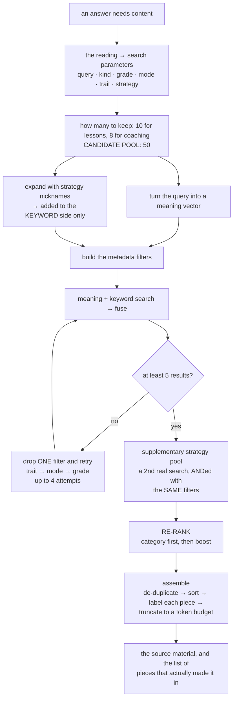

# 07 — Finding the Right Content

Before the model writes anything, this stage has to find the handful of passages, out of the
client's whole body of material, that the answer must be built from.

**The shape:** a locally-held searchable index, queried **twice in parallel** — once by meaning,
once by keyword — fused, then **re-ranked by source priority**.

> That last step is **the product rule, not a search nicety.** The client's number-one
> non-negotiable is *"always, always, always start from the Launch books."*

---

## 7.1 The index

| | |
|---|---|
| **Where it lives** | A **folder on disk**, not a server. No network hop, no per-query cost |
| **What's in it** | **703** searchable pieces — the 710 hand-crafted pieces of content, minus 7 that describe the four-step method itself and are **built into the model's instructions** instead |
| **Meaning vectors** | 3,072 dimensions, cosine similarity |
| **Keyword index** | A classic keyword-ranking algorithm |
| **Coverage** | **All 703 carry both** representations and the same set of descriptive labels. Keyword terms per piece: as few as 26, typically ~102, as many as 287 |

> ⚠️ **The folder takes an exclusive lock.** A second process opening it fails — which is why every
> content lookup starts failing if two engines run. See [Chapter 12](12-running-and-ops.md).

---

## 7.2 The fusion — and why the numbers look the way they do

Both searches run with the same filters and the same limit, and the two result lists are combined
by **reciprocal-rank fusion**: each list contributes a score based on a document's *position*, and
the contributions are summed.

Three consequences worth internalising:

1. **A piece ranked first in both lists scores the maximum, which is 1.0** — and a piece found by
   only one of the two searches can never exceed half that.
2. **The fused score is a *rank* artefact, not a similarity.** The re-ranking stage then multiplies
   it by factors between 0.3 and 2.5 — so **a boost is worth roughly "a few ranks."**
3. **The fusion constant is not configurable from our side.** We take the library's default, which
   is *not* the value from the original published method. **Upgrading that library could change the
   constant underneath us.**

---

## 7.3 The pipeline

### The candidate pool

The number of results ultimately kept is small — **10** for lessons, **8** for coaching. But the
**candidate pool considered by the re-ranker is 50.**

> The reason is recorded in the system: the old, smaller pool **frequently never surfaced the
> client's own book content into the re-ranker's view at all.** You cannot promote what you never
> retrieved.

> 🔴 **…except on the flagship path, where it isn't 10.** The mini-lesson path labels its request
> with a slightly different word than the one both consumers check for. The result is that the
> flagship request silently gets:
>
> - the **coaching** result count of **8**, not 10; and
> - **no content-mode filter at all**, because that filter is only applied for the expected label.
>
> The shared path used by the other answer types labels the same request **correctly**. Nothing
> pins the value. Whether this is intentional is **unverified** — but it is exactly this project's
> recurring shape: **two paths, one quietly disagreeing, and passing checks either way.** Treat it
> as a likely defect worth measuring.

### Expansion by strategy nickname

The 46 named strategies each carry **spoken synonyms** and **descriptive keywords**.

> 🔴 **The documented bug class.** Historically the matcher checked **only the descriptive
> keywords.** The spoken nicknames sat in a field that was **produced as output and never matched
> against.**
>
> So expansion fired when a teacher *described* a skill (*"paragraph writing"*) and **never when
> they named it** (*"the pizza table strategy"*) — **the exact inverse of the client's
> non-negotiable.**
>
> Fixed by adding the name and its synonyms to what is matched. All three are matched today.

Two details in the matcher worth copying:

- **Whole-word, never substring** — and deliberately not the standard word-boundary rule, because
  strategy names carry punctuation, and the standard rule plus a short name like *"pat"* is how you
  get a match inside **"pattern"**.
- Normalisation turns every dash variant into a space, so *"read up write down"* equals
  *"read-up-write-down"*.

> **The matched synonyms are added to the keyword side only.** The meaning vector is built from the
> raw question and is deliberately *not* expanded.

> And note: expansion runs off the **teacher's raw words**, not the strategies the understanding
> pass extracted — deliberately, because relying on that was **measured to be a coin flip.**

### The filters

| Filter | Notes |
|---|---|
| Content mode (lesson-generation vs coaching) | Applied for lessons only — coaching deliberately searches everything |
| Grade | See below |
| Writing mode | The stated mode, or content marked as mode-agnostic |
| Trait | **Suppressed when the teacher named a strategy** — the content's own canonical trait beats an inferred one, and a hard trait filter is *"a silent exclusion trap"* |
| Strategy name | **Never filtered on** — names vary between what teachers say and how content is labelled. It only *gates* the trait filter |

### Grade handling — one vocabulary, hard-won

A single table maps each individual grade to every range label that covers it. Two derived passes
sit on top:

- **The earliest-writer range is folded into the youngest grades** — drawing and labelling content
  is labelled for pre-readers and must still be reachable for those grades.
- **Band keys are added as the union of their member grades' entries** — **derived, not
  hand-written.**

> The reason this is one table is recorded plainly: the fact used to live in **two hand-maintained
> inverse tables, they drifted**, and **all six earliest-writer lessons became unreachable at every
> individual grade — silently.**
>
> And before band keys existed, a band coming out of the understanding pass fell through the lookup
> and **skipped the grade filter entirely.**

The lesson library reuses the **same** table. That single decision closed a whole bug class.

### Progressive relaxation

Up to **four attempts**. If a pass returns fewer than **five** results, drop **one** filter and
retry: trait → mode → grade. An empty filter set is converted to *no filter at all*, because the
index treats those two differently.

### The supplementary strategy pool

When expansion matched named strategies, a **second real search** runs, scoped to content tagged
with those strategies.

> ⚠️ It is **combined with the same filters the main search used**, and that is enforced rather
> than optional — because it previously ran **unfiltered**, so its results **bypassed the grade
> filter and an out-of-band piece could become a citation.**
>
> Measured harm at the time: **8 of 245 citations out of band** — all upper-grade paragraphing
> questions **citing the K-2 book.**

---

## 7.4 The re-ranker — where "the client's books first" is actually enforced

For each candidate: compute a **category**, compute a **boost**, multiply the fused score by the
boost, then sort by **category first, score second**.

> **The two-level sort is the whole point: the category is absolute and wins outright; the boost
> only orders items *within* a category.**

The reason is recorded: a pure multiplier **failed**. Reference material out-earned the client's
own lessons because a higher base score times a smaller boost beat a lower base score times a
larger one. **A score bonus is not a guarantee. A category is.**

### The five categories

**0 is best, 4 is worst — and the meaning depends on what was asked.**

**A universal rule first:** an *overview* piece under any skill-seeking question drops to the
bottom category. Overviews describe a section; they don't teach.

**For unit planning:** the scope-and-sequence reference is **top** — it is the canonical source for
priority skills. The client's books come next. Everything else is well below.

**For classroom management:** the routines sections of the books are **top**; the *skills* sections
of the same books drop to the **bottom** (wrong audience); two specific course episodes sit just
below the top; everything else in between.

**For everything else** — lessons, how-to-teach, coaching, think-alouds — in order of evaluation:

| Category | Condition |
|---|---|
| **0** | The client's book, **and** the writing mode appears in the lesson's own title |
| **0** | The client's book, **and** its scope-and-sequence labels mark this mode essential for the teacher's band |
| **0** | The client's book, **and** a scripted lesson whose mode matches |
| **0** | A library-backed piece with a matching band and mode |
| **4** | The client's book, **but from the routines sections** — **the "sink"** |
| **1** | Any other content from the client's books |
| **1** | Any library-backed piece |
| **2** | Reference material and core methodology documents |
| **3** | Course episode transcripts |
| **4** | Everything else |

### 🎯 The sink, and its escape hatch — the best-designed thing here

The routines sections are the wrong half of the book for a *"teach me this skill"* question, so
they are demoted **below even non-client content**.

But that created a real defect: when a teacher **named** a lesson that lives in those sections, it
became unreachable **at any score** — one measured case ranked **34th**, with a raw score higher
than the item that won.

So there is a bounded escape hatch: if a piece carries a **matched strategy tag** and its boosted
value has climbed back to neutral, a sunk piece is **restored to the ordinary category.** The
principle, recorded in the system:

> **The sink is a heuristic about relevance. A teacher naming the lesson is a fact. The fact
> wins.**

And the arithmetic is chosen so the escape is **bounded**:

| Case | Arithmetic | Result |
|---|---|---|
| Wrong *section* for the question | penalty × strategy boost lands **above** neutral | **escapes** |
| Wrong *audience* (grade band) | lands **below** neutral | **stays sunk** |
| Wrong *book* for an early writer | lands **well below** neutral | **stays sunk** |

> **The grade lock therefore outranks the naming rule *by construction*, not by a second rule.**
> That is genuinely elegant: the numbers encode the priority, so there is no ordering rule for
> someone to get wrong later.

The sink is also skipped entirely for coaching and earliest-writer questions, because those don't
apply the matching boost — **and a category that contradicts its own boost is a known regression
class here.**

### The boosts

All multiply the fused score; neutral is 1.0. A representative slice:

| Boost | Value | When |
|---|---|---|
| Mode appears in the lesson title | **2.2** | Deliberately just above the next one, so a title-dedicated piece edges ahead on an equal score |
| Band + mode scope tag | 2.0 | The client's primary case |
| Library-backed + mode | 1.8 | |
| A scripted lesson whose mode matches | 1.5 | |
| **Named-strategy tag matched** | **1.5** | Applied on top of the type boost — this is what powers the escape hatch |
| The scope-and-sequence, for unit planning | **2.5** | The highest factor anywhere |
| An overview under a skill question | **0.5** | |
| Wrong section | 0.7 | |
| Wrong management audience | 0.4 | |
| Wrong book for an early writer | **0.3** | The floor |

---

## 7.5 Assembly — what the model actually sees

1. **De-duplicate**, keeping the better-ranked copy.
2. **Sort by category, then score** — reproducing the re-ranker's order.
3. **Label every piece** with an identifier, its type, grade, trait, mode, **book title and page**.

> **The identifier comes first, and the identifier/page pair is what makes a citation checkable.**
> The book line resolves internal shorthand into the **teacher-facing full title**. This labelling
> is the entire contract behind *"the model points, the logic speaks"* — see
> [Chapter 8](08-handlers.md).

4. **Truncate to a ~10,000-token budget** — with one exception: complete scripted lessons and
   think-aloud material are treated as priority and may exceed it by half again.

5. Return **both the assembled material and the list of pieces that actually made it in.**

> ⚠️ **That second value matters.** Citations resolve against the pieces that **made it in**, not
> the raw search results — because *"what search found"* and *"what the model could have named"*
> are different questions. The recorded sources come from the raw list; the citation comes from the
> assembled one.

---

## 7.6 Gotchas

1. 🔴 **Detection of "is this from the client's books?" is running entirely on its fallback.** The
   primary check compares against two internal short-codes — and **those match zero of the 703
   pieces**, because the content stores **full book titles** instead. Detection survives only
   because of a secondary check on the source document name. The offline labelling tool still
   *emits* the old short-codes, so the tool and the content disagree about that field's vocabulary
   — and **the same abandoned vocabulary is the key of the book-title lookup used when assembling
   source material**, so *that* lookup never hits either, and correct titles emerge only via the
   same fallback. **One dead vocabulary, two live systems leaning on fallbacks.**
2. **There are two similarly-named "tier" concepts.** One is a label stored on the content that is
   **read but never used for ranking** — and it has exactly **one distinct value across all 710
   pieces**. The other is the category the re-ranker computes at query time. Don't confuse them.
3. **The un-ranked default sinks rather than floats.** A piece that never passed through the
   re-ranker is given an extreme value so it lands at the bottom, rather than silently ranking
   first.
4. **The score is mutated in place** by the re-ranker. The value you see downstream is the
   *boosted* one, not the fused one.
5. **The layer that calls this deliberately does not re-rank** — re-ranking twice **squared the
   boost**.
6. **The mini-lesson path has its own copy of the search seam**, separate from the shared one used
   by the other answer types. That duplication is the root of gotcha (1) in §7.3.
7. **A priority field exists on every piece of content and the re-ranker does not read it.**
8. **An overview check has a permanently dead branch** — it reads a label that the in-memory
   representation doesn't carry, even though all 703 stored pieces have one.
9. **Three of the four possible library-lookup outcomes have no production consumer** — only tests
   and probes.
10. **The lesson library is not loaded at startup**, despite documentation saying it is. The
    ~93 MB parse happens on the **first request**.

---

## 7.7 Check yourself

1. A piece ranked first by meaning and first by keyword gets what fused score, and why is that the
   maximum possible?
2. Why is *"the client's books first"* implemented as an absolute category rather than a large
   score bonus? Give the arithmetic that killed the bonus approach.
3. A teacher names a lesson that lives in the sections the re-ranker deliberately sinks. What lifts
   it back — and why can that same mechanism **not** rescue a wrong-grade piece?
4. Expansion once fired when a teacher *described* a skill and never when they *named* it. What
   exactly was being matched, and why is that the inverse of what the client asked for?
5. Why must the supplementary search carry the same filters as the main one? What went wrong when
   it didn't?

---

**Next:** [08 — The Nine Kinds of Answer](08-handlers.md)
