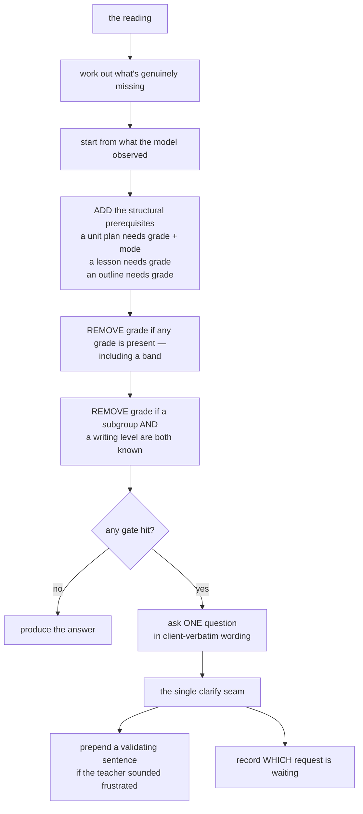
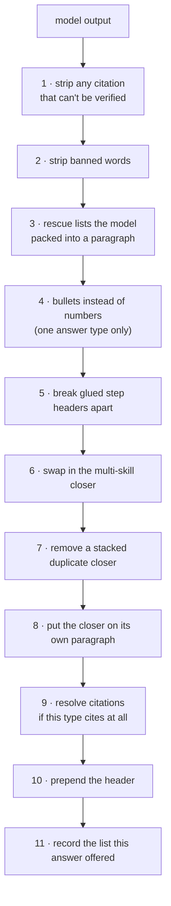

# 08 — The Nine Kinds of Answer

This is where the product behaviour actually lives. The understanding pass decides *what kind* of
question this is; this stage decides *what the answer looks like*.

---

## 8.1 Two shapes, nine types

There are nine request types but only **two output shapes**:

| Shape | Types | Mechanism |
|---|---|---|
| **Structured lesson** | Scripted mini-lesson | A required four-step structure, enforced at generation time |
| **Prose** | How-to-teach · coaching · management · plan-a-unit · think-aloud | One shared write→check→retry loop |
| *(neither)* | Meta | **Fixed text. No model call, no search** |
| *(delegating)* | Deepen-the-previous · correction | Inherit facts from earlier turns, then re-route to one of the above |

Every answer type produces the **same contract**, so the delivery boundary treats them uniformly.
An unroutable type is an **outright error** on purpose — *explicit failure beats silent routing to
a default.*

Only three types are given access to the AI quality judge — the mini-lesson type and the two
delegating types, and the latter two only because they can hand off to it.

---

## 8.2 The clarify gate — before any answer, before any model call

If the request is under-specified, **no answer and no model call ever runs.**

### The gates

| Gate | Applies to |
|---|---|
| Unrecognised acronym | **every** type |
| A subgroup mentioned but no writing level | the four lesson/outline types |
| Grade missing | mini-lesson, how-to-teach, plan-a-unit, think-aloud |
| Skill missing | mini-lesson, think-aloud, deepen-the-previous |
| Mode missing | plan-a-unit |
| *Anything* missing | management |

### The exact wording (client-approved)

| Situation | The question |
|---|---|
| Grade | *"What grade level do you teach?"* |
| Skill | *"What writing skill are you working on?"* |
| Mode | *"Are you preparing for a persuasive, informative, or narrative unit?"* |
| Management | *"What area of management are you struggling with?"* |
| Unknown acronym | *"What does that acronym stand for? Each state has different names/acronyms for the same subgroups."* |
| Writing level | *"What's their current writing level — are they at the picture, label, word, or sentence stage?"* |
| Re-showing a list | *"Which skill from the list I just shared would you like a lesson for? Reply with the number or the skill name."* + the list |

Questions are **composed from what is still missing**, which is what stops a fact the teacher
already gave from being asked again.

### Three subtleties worth knowing

1. **What the model "observed" as missing is an observation, not policy.** The structural
   prerequisites are *derived* rather than trusted — measured against production, the writing mode
   was genuinely absent ten times out of ten while the model flagged it only five, swinging between
   identical runs.
2. **"Skill" is deliberately excluded from the derived prerequisites** — whether a skill can be
   *inherited* from context is a judgment, and stays with the model.
3. **The writing-level-supplants-grade rule is scoped to a subgroup context.** Without that guard,
   a stage word extracted from a skill name like *"labelling multiple details in one picture"*
   dropped the grade question entirely.

---

## 8.3 The nine, one at a time

All five prose types run at low randomness, up to **three attempts**, and get their header from one
central place.

### Scripted mini-lesson — the flagship

The only structured path. Covered in depth in [Chapter 9](09-generation-and-validation.md).

| | |
|---|---|
| **Teacher says** | *"Give me a mini-lesson on topic sentences, grade 3"* |
| **Shape** | The four-step script, with each step separately checked |
| **Header** | `Grade 3 \| Informative` |
| **Cites?** | Yes — one citation, from the source the model names |

### How to teach

| | |
|---|---|
| **Teacher says** | *"How do I teach 4th graders to write a strong topic sentence?"* |
| **Shape** | One opening sentence naming the skill and a named strategy, then **bullets** — 3–5 discrete sub-skills, one or two sentences each |
| **Closer (one skill)** | *"Are you ready for a scripted mini-lesson on this skill?"* |
| **Closer (several skills)** | *"Which of these skills do you want to start with? You can't teach them all in a single lesson."* |
| **Cites?** | **Yes** — per claim |

> The multi-skill closer is **swapped in automatically** when the rendered outline lists more than
> one skill — because *"this skill"* has no referent after 3–5 were listed. That was a real client
> complaint: *"Three, four, and five are skills… we can't have a mini-lesson with all of this. Too
> many skills."*

A deterministic backstop also converts numbered lines to bullets **for this type only** — the
client's rule that numbers mean *sequence*, and a menu of sub-skills isn't one.

### Plan a unit

| | |
|---|---|
| **Teacher says** | *"Plan a 4th grade persuasive unit"* |
| **Shape** | A **template-built** opening sentence, then a **numbered** list of 3–7 priority skills in teaching order, then a short framing paragraph |
| **Closer** | *"Is this helpful? Would you like a general outline of this unit?"* |
| **Cites?** | No |

> **Why the opening sentence is built from a template:** the previous version let the model write
> *"For {grade} {mode} writing…"* — and on the grade-less path it **invented a grade four times out
> of four**, and leaked the raw internal mode token. Now it is a template with no room to
> improvise.

> ⚠️ **This is the one type where "what must be present" and "where the closer starts" differ.**
> The *required* fragment for checking is the second half of the sentence; the *anchor* used to
> push the closer onto its own paragraph is the first half. Anchoring on the requirement **split
> the client's sentence in half mid-clause, live.**

### Think-aloud

| | |
|---|---|
| **Teacher says** | *"Show me a five-minute think-aloud for adding sensory details"* |
| **Shape** | One block of **first-person narrative prose**. No bullets, no step headers |
| **Closer** | *"Want me to wrap this in a scripted mini-lesson?"* |
| **Cites?** | No |

**Length scales with the ask** — a three-case rule: a stated duration is a **floor** at roughly 150
words per minute (five minutes → at least 700 words); a qualitative signal like *"brief"* or *"in
depth"* maps to a band; and there is a default when neither is given.

### Coaching — the catch-all

| | |
|---|---|
| **Teacher says** | *"Tell me about the pizza-table strategy"* · *"We taught it and they still can't do it"* |
| **Shape** | Two to four short paragraphs, roughly 250–450 words |
| **Header** | Grade and mode — or **none at all** when grade is unknown, which is common here |
| **Closer** | A natural offer, **or** *"Does this make sense? Is this helpful?"* |
| **Cites?** | **Yes** — per claim |

**Its search focus is dynamic** — the only type where that's true. If the reading names a skill it
searches as coaching; otherwise it looks back to the most recent teacher turn, and if *that* was
about management, **this turn searches management content**.

> That exists because "routines and procedures" is a **focus that persists across a bare
> follow-up**. A plain *"Can you expand on those?"* used to force the coaching focus, silently
> discarding the management scoping and pulling writing-skill lessons instead of workshop
> sections.

Note the deliberate asymmetry: only the *search* focus moves. The checks still treat it as
coaching, so the closer requirement stays put.

It also carries a strong **resource-existence** rule: never assert that something in the client's
books doesn't exist; point at the book and its digital resources first; improvising your own is a
distant second.

> The system carries an unusually honest internal note here: per-claim citation on coaching is
> **our** uniform application of a rule the client anchored on a different answer type — **not his
> ask.** That kind of note is exactly what this project learned to write down.

### Management

| | |
|---|---|
| **Teacher says** | *"How do I set up writers' workshop routines?"* |
| **Shape** | Two to four paragraphs, biased toward the routine-oriented front sections of the books |
| **Header** | `Grade X \| Management` — the label **replaces the mode adjective**, because a routine has no writing mode |
| **Closer** | *"This was an overview. Which ONE area or SINGLE routine would you like to start with?"* |
| **Cites?** | No |

> ⚠️ The management closer **replaces** the generic one rather than stacking with it, and the
> ending check keys on its distinctive fragments.

### Meta — no model, ever

Four fixed replies, chosen by keyword markers in strict priority order. **No search, no model call,
no checks, no header.**

| Trigger | Reply |
|---|---|
| PDF / export / copy-ready / copy & paste | *"I can't generate or attach a PDF directly here, but you can copy & paste this text into Google Docs or Word and save as a PDF."* |
| *"how does this work"* / *"what can you do"* | A capability overview |
| A greeting **under 40 characters** | A warm greeting and an invitation to start |
| Anything *writing-related* but vague | The capability reply again — **a warm redirect, never a refusal** |
| Genuinely off-topic | A polite boundary: outside my scope, happy to help with writing instruction |

Two details that matter:

- The PDF reply is the client's own redline **verbatim**, with two struck-through clauses removed.
  **It deliberately promises no follow-up action** — his complaint was an offer the assistant then
  couldn't honour.
- Matching is **whole-word** after stripping punctuation from word *edges* only — so *"Hi!"*
  matches a greeting, while hyphenated and slashed compounds survive as single tokens. And the bare
  word *"copy"* is deliberately **not** a marker, so *"copy the sentence for me"* gets the writing
  redirect rather than the PDF reply.

### Deepen the previous — inherit, then delegate

*"put this in a lesson"* · *"show me just the think-aloud"* · *"go deeper"*

1. **Find the prior context** — walk back to the most recent **valid** answer, then further back to
   the teacher turn that carried a reading.
2. **Pick a target type** by keyword, in fixed precedence: lesson words → think-aloud words →
   unit-plan words → outline words → *(if the previous turn was management)* management → default
   to a lesson.
3. **Merge** — fill grade, mode, trait and skill from the previous turn **only where the current
   value is absent**, and carry named strategies forward when this turn named none.
4. **Carry the organizer** — hand the previous answer's text forward as a must-incorporate block,
   **unless** the previous answer was itself a lesson (continuity already flows through the
   inherited facts).
5. **Delegate.**

> ⚠️ **Two keyword traps recorded in the system:** *"four-step"* is in the *lesson* bucket on
> purpose — *"put the think-aloud into a four-step lesson"* contains no *"lesson"* substring on its
> own and used to fall into the think-aloud bucket and return prose. And a bare two-letter
> abbreviation must never be a keyword, because **it matches inside other words.**

> ⚠️ After merging, the reading is passed back through the **pointer resolver** — because *"that"*
> is *not absent*, so it survives the inheritance rule and would otherwise be rendered verbatim as
> the lesson title: *"Today we're going to focus on that."*

### Correction — accumulate, then re-run the same type

*"Actually, make it 7th grade"*

**The distinction from deepen-the-previous:** deepening changes the **form**; correction keeps the
form and fixes a **fact**.

**Corrections accumulate.** The logic walks back through teacher turns collecting every
intervening correction until it reaches the first correctable request — the **base** — then folds
the corrections onto it **oldest-first**, reusing the same merge rule.

> Without that fold, a second correction would re-anchor on the base and **silently drop the first
> one's change.**

Measured: a grade-3 informative lesson → *"make it grade 4"* → *"make it narrative"* yields a
grade-4 **narrative** lesson. Both changes survive.

What the merge keeps from where:

| Fact | Source |
|---|---|
| The request type | **always the previous one** — that's the entire point |
| grade / mode / trait / skill | the current turn wins when present, otherwise the previous |
| Named strategies | the current turn wins only when non-empty |
| Everything about *this* turn's phrasing | always the current pass — previous values are stale by definition |

With no previous request to correct, it falls back to coaching and treats the message as a fresh
question.

---

## 8.4 The shared prose machinery

Five answer types share one loop. Each supplies exactly four things: **how to build the
instruction**, **which checks to run**, **a type label**, and *optionally* **a way to resolve
citations**.

### The delivery pipeline — order is load-bearing

**Two orderings cannot be swapped, and both have shipped as bugs:**

| Constraint | The failure if violated |
|---|---|
| Citations must resolve **after** the strippers | The stripper blanks the book title of a citation just built → **"If you have the '' book, you'll find this lesson on p.64."** — that blank slot actually reached teachers |
| Citations must resolve **before** the offered list is recorded | A citation entering the text afterwards can **truncate the list**, so *"number 4"* falls out of range and the teacher silently gets item 3 |

Every transformation is documented as **cosmetic and repeatable**, and the two riskiest are
*provably bounded*: the duplicate-closer removal only commits when what's removed is the generic
closer **and** what remains still ends with a valid offer — so it can only turn "valid with two
questions" into "valid with one."

### The three-exit retry loop

1. **Pass** → ship it.
2. **Trust-the-model fallback** — from the second attempt onward, if **every** remaining complaint
   is one where the model's judgment is likely better than the rule, ship anyway, **keeping the
   complaints on the record** for audit.
3. **Exhaustion** → ship the best of three, marked low quality.

> The trust list is **wider** for prose than for lessons: it adds the *"story"* rule, because in
> free prose *"the data tells a story"* is legitimate. The vocabulary rule is deliberately
> excluded, because its grade condition is reliable.

---

## 8.5 Why rules are shared rather than copied

**The recurring defect:** a client rule was written into exactly one answer type's instruction —
and then the teacher's phrasing routed the question to a **different** type, so the rule silently
didn't apply.

The clearest recorded case: the *"validate the teacher's frustration before giving advice"* rule
lived only in coaching, so it fired only when a frustrated opener happened to route there.
**Measured live, it fired roughly one time in four** — described internally as *"a routing
lottery, because the rule was tied to one answer type while frustration is orthogonal to what was
asked."*

**The fix pattern, every time:**

> **The understanding pass makes the semantic judgment → a plain flag lands on the reading → one
> shared rule is spliced into every relevant instruction, gated on that flag.**

Which rules are shared, and who opts in:

| Rule | Applied to | Gate |
|---|---|---|
| The vocabulary rules | **all six** instruction builders | always |
| A single closing question | coaching | always |
| The management closer | management | always — **replaces** the above |
| List formatting | how-to-teach, coaching, management | always |
| Per-claim source marking | how-to-teach, coaching | always (self-limiting) |
| Early-writer stage | mini-lesson, how-to-teach, coaching | if a writing level is known |
| Early-writer stage **per bullet** | how-to-teach, coaching | same gate — **deliberately not** the mini-lesson, which has no bulleted list |
| Affirm a teacher's own ordering | plan-a-unit, coaching | always — the rule self-gates in its own text |
| Frustration validation *(instruction)* | **all five** prose types | if frustration was flagged |
| Frustration validation *(clarify)* | the clarify seam | if frustration was flagged |

### The sharpest illustration — why that last pair must be two rules

The **instruction** version only exists if a model call happens at all. But a frustrated
**first-contact** message with a missing grade short-circuits at the clarify gate with **no model
call** — so that instruction can never run.

The **clarify** version is the deterministic counterpart: a fixed sentence, prepended at the one
seam every clarify flows through, so it covers every gate alike. It deliberately carries no grade
or skill specifics, because it renders exactly when those are unknown.

### What is deliberately *absent* from these shared rules

No rationale (*"an instruction is not a scratchpad"*), no example citation (handing the model a
page-shaped example is how a reverted attempt leaked internal labels to teachers), and no
instruction to cite *everything* — a claim is *eligible* to be cited, never obliged.

> There's a matching note elsewhere in the system: *"an earlier fix once fed the model the exact
> phrasing it was trying to remove."*

---

## 8.6 Citations — "the model points, the logic speaks"

The model is the only thing that knows which retrieved passage it actually taught from. So it
**points**, and the logic **speaks** the sentence from that passage's stored labels. **The model
is never asked to write a book title or a page number.**

Two pointing mechanisms:

| Path | Mechanism |
|---|---|
| The mini-lesson | The structured lesson carries **one** field naming the source it was built from |
| How-to-teach and coaching | The model appends a **marker at the end of each claim's own line**, and a resolver turns markers into sentences in place |

The other three types pass no resolver and stay uncited **by construction** — with no
type-checking branch anywhere in the shared loop.

### One template

> *"If you have the '<book title>' book, you'll find this lesson on p.64."*
> *"…on pages 97, 111."*

It **refuses to emit a half-known citation.** A blank page slot is literally what an earlier,
instruction-based attempt shipped to teachers.

> A lovely detail: the plural branch tests *"is this a collection?"* rather than *"is this a
> number?"* — because a string is also iterable, and a number-typed test would drop `"64"` into the
> plural branch and iterate its characters into **"pages 6, 4."**

### Silence by construction

A citation is produced **only** if all of these hold: the model named a source · that source is
among the passages actually assembled **this turn** · it has a full book title · it has a page ·
**and that page appears in the assembled material.**

If the named source is found but isn't citeable, the result is **silence** — never a fallback to
some other source. **Falling back to whatever ranked first is the defect this whole design
replaces.**

### The identity gate

**Provenance is not identity.** On a bare follow-up, search drifts, the real lesson is absent, the
model describes it from memory and marks the nearest retrieved decoy — whose page is legitimately
present.

So when a claim is supplied, the source must *also* be corroborated as the lesson the claim is
about:

- **Never-cite rule:** an *overview* piece — a section overview, a pacing guide, a whole-book
  rubric — is rejected outright. Citing one as *"this **lesson** on p.N"* is a category error.
- Otherwise: compare the source's identifier, title, strategy name and tags against the claim on
  two axes — a **shared named strategy**, or a **shared distinctive word** (numbers, very short
  words and ~120 common words excluded).
- **Fail direction:** indeterminate → **cite**. Only a *proven* mismatch → **stay silent.** The
  gate is narrow on purpose; over-suppressing a correct citation is the bigger risk.
- The source's *body text* is never used — a full lesson would match almost any claim.

### The two-pattern marker contract

There are **two** patterns for the claim marker, and the wider one is **deliberately not derived
from the narrower**:

| Pattern | Job |
|---|---|
| Narrow | What the model is *asked* to emit; the only shape that resolves |
| **Wide** | The **unconditional final sweep** |

> Why: the citation stripper runs first and can rewrite characters *inside* a source identifier —
> **11 of the 710 identifiers are affected** — producing a shape the narrow pattern no longer
> recognises. A sweep bound to the emission grammar would ship a **raw marker to a teacher.**
>
> **The narrow one recognises; the wide one removes.**

### Placement hygiene

- **A citation joins its claim's own line** — never a line of its own. (List scanning ends at the
  first non-list line, so a citation on its own line mid-list would truncate the offered list.)
- Never after a line ending in a colon or a question mark.
- Grouped **by book**, pages joined **in ascending order** and de-duplicated — 31 of 225 book/page
  locations hold more than one piece of content.
- A citation identical to one already given earlier in the same answer is dropped.

### The page-lookup rule

*"What page is that lesson on?"* is **referent-less** — search re-runs on those words alone and
returns generic material, never the lesson being asked about.

So both citing types detect that case and resolve markers **against an empty source list**: the
sweep still removes every marker (nothing raw leaks) but there is nothing to cite, so the answer
**stays silent**. A *fresh* page question, which retrieved its own lesson, still cites correctly.

The detector is a **fixed set of nine phrasings**, never a general classifier.

---

## 8.7 Offered lists — an ordinal is arithmetic, a name is judgment

The offered list is extracted from the **final delivered text**, taking the lead sentence of each
item of the **first** list.

Two subtleties:

- **Blank lines do not end the list.** The client's approved paragraph-block format puts a blank
  line between every item, and treating blank as a terminator once returned **a single item holding
  an entire paragraph**. Prose after the list *does* end it.
- **No type gate.** Any answer rendering a countable list offers picks — a coaching or management
  answer that lists options is as pointable as a unit outline.

There is also a narrow prefix strip: *"Teach students to build a paragraph"* becomes *"build a
paragraph"* — because naming a lesson with a bullet aimed at the *teacher* renders as *"today we're
going to Teach students to build a paragraph"* inside a script read aloud to children. A phrasing
where stripping would leave a bare noun phrase is deliberately left alone.

---

## 8.8 Gotchas

1. **The package named for generation contains no generation logic.** The model call for a lesson
   lives with the lesson answer type.
2. **The one-skill warning is written to two places** — into the prose *and* into the structured
   form — because on the lesson path the prose is discarded at the delivery boundary.
3. **The recorded sources and the citation sources are different lists, on purpose.** Recorded
   sources come from the **raw** search results; citations resolve against the **assembled** ones.
   Using the raw list would be wrong in both directions.
4. **The instruction's marker grammar and the resolver's pattern must stay pinned together.** If
   they drift, every marker resolves to nothing and citations vanish **silently and with everything
   passing** — because the sweep removes what it cannot resolve. A check binds them.
5. **Coaching's search focus and its checking label deliberately disagree.** Intentional, but
   surprising: the ranker can be treating a turn as management while the ending check treats it as
   coaching.
6. **Both search helpers swallow a signature mismatch and retry with only the query.** Change the
   search interface and a mismatch **degrades silently** into an unfiltered search rather than
   failing loudly.
7. **A grade-less lesson gets the older band's closing line** by default — for a grade nobody gave.
   The clarify gate normally prevents that, so weakening the gate re-opens it.
8. **On the mini-lesson path the never-cite-an-overview rule is bypassed** — the identity gate only
   runs on the marker path.
9. **Several parts of the answer contract are dead**: a slot for updating pending state, a second
   source list, and a library-match identifier that is written once and never read.

---

## 8.9 Check yourself

1. The *"validate the frustration first"* rule exists as **two** separate rules. Why can one not do
   the job of the other?
2. The delivery pipeline runs eleven transformations in a fixed order. Give two adjacent pairs whose
   order cannot be swapped, and the concrete failure each swap causes.
3. A teacher asks *"what page is that on?"* right after a lesson. What does the assistant do, and
   why is that the right answer rather than a bug?
4. A teacher says *"actually make it 7th grade"* and then *"and make it persuasive."* What kind of
   answer runs, and what happens to the first correction?
5. Why is the marker-removal pattern deliberately **not** derived from the marker-emission
   grammar?

---

**Next:** [09 — Writing and Checking a Lesson](09-generation-and-validation.md)
