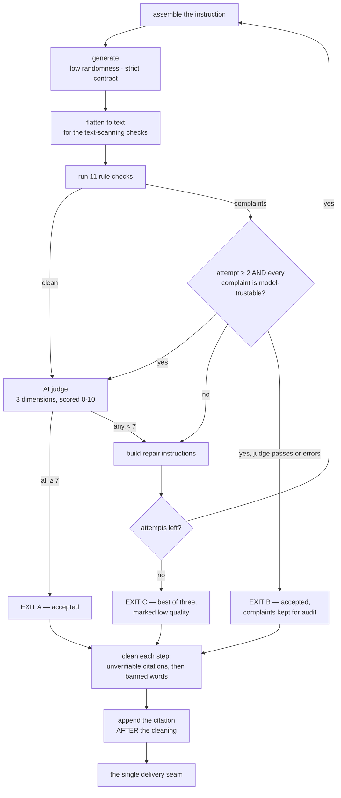

# 09 — Writing and Checking a Lesson

The writer is a language model, and a language model will happily produce a mini-lesson that is
90% right and 10% career-ending for the client. It will use a banned word, invent a page number a
teacher will then fail to find in their physical book, or write a think-aloud that narrates in the
**third** person instead of modelling out loud.

This stage is the safety net between the model and the teacher.

> **Nothing here ever blocks delivery.** The worst outcome is that the teacher receives the best of
> three attempts, marked as low quality.

---

## 9.1 The four-step structure

The lesson is produced under a **strict output contract**, so the model cannot return a shape that
doesn't fit.

| Piece | Notes |
|---|---|
| **Skill focus** | The teacher's **exact vocabulary**, preserved |
| **Lesson title** | The model's **verb-led** restatement, for display |
| **Grade / mode** | |
| **Step 1 — Introduce** | 2–3 sentences, ~30 seconds |
| **Step 2A — Tell** | Under 5 minutes of explanation |
| **Step 2B — Show** | ~5 minutes of think-aloud |
| **Step 3 — Interact** | ~5 minutes of student participation |
| **Step 4 — Close** | 3–4 sentences |
| **The source it was built from** | **The one piece the teacher never sees** — an identifier naming the passage the lesson came from |

**Steps 2A and 2B are genuinely separate pieces**, not one "Step 2". That separation *is* the
method's gradual-release model (Tell, then Show), and the checks score them independently.

Two subtleties:

- Under a strict contract **every** piece is required. The lesson title has a technical default
  only so that code paths — an abort case, a test fixture — can construct a lesson without it.
  **The model must always author it.**
- The source identifier is allowed to be empty but **not omitted** — so the model must answer it on
  every lesson, with "nothing" as an explicit answer.

### Two titles, deliberately

| | |
|---|---|
| **Skill focus** | The teacher's words — *checked, never rewritten* |
| **Lesson title** | A verb-led statement — the client: *"I love that it's a verb. It's a statement."* |

Both are capitalised at the **first character only** — not word-by-word, which would lowercase the
remainder and destroy proper nouns.

> ⚠️ **A banned word in the title would otherwise survive everything**, because the step-cleaning
> pass covers only the five steps, and the text checks run over a rendering built from the *skill
> focus*. Hence a **dedicated title cleaning pass.**

---

## 9.2 How the instruction is assembled

Eight to ten parts, joined in a **stable-first order** so the unchanging portion can be cached
between calls:

1. The static rule block
2. The global vocabulary rules
3. *(if a writing level is known)* the early-writer rule
4. What the teacher has established so far
5. **The Step-4 closing requirement**
6. *(if any)* a conversation excerpt
7. The retrieved source material
8. *(follow-ups only)* a graphic organizer carried from the previous answer
9. *(if a second skill was crammed in)* the one-skill scope note
10. *(retries only)* an explicit "your previous attempt failed — fix these" block

The static block covers: the verb-led title rule · Step 1's four required components (link, name,
purpose, trait) · the depth requirements · the first-person monologue requirement · the four exact
Step-3 phrases · Step 4 · always explain a strategy when you name it · grounding · banned words ·
teacher-facing language (never mention retrieval machinery) · and classroom pacing with a
single-step ceiling.

### The grounding rule is two-sided

> The instruction tells the model **not** to write a book or page citation — *"a pointer to the
> book is added for you automatically"* — and tells it to record **which source it built from.**
>
> **The model points; the logic speaks.**

An earlier attempt that let the model format citations itself leaked literal internal labels and
blank page slots to teachers, and was reverted.

### The anti-drift pattern worth copying

The Step-4 block **reads the required closing phrase out of the very same table the check uses**.
The instruction imports it. The check imports it. **They cannot disagree.**

---

## 9.3 The write → check → judge → repair loop



**Attempt cap: three.**

> ⚠️ A configuration setting for this exists with the same value and **is read by nothing**.
> Neither are the settings for generation randomness or the judge threshold. They are knobs that do
> nothing.

### The three exits

| Exit | When | Result |
|---|---|---|
| **A — clean pass** | No rule complaints, judge passes | Accepted |
| **B — the trust-the-model fallback** | From attempt two, **and every remaining complaint** is one where the model's judgment is likely better than the rule | Accepted, with the complaints **kept on the record** for audit |
| **C — exhaustion** | All three failed | Best of three, marked low quality |

**"Model-trustable"** means: a banned-word flag where the word may legitimately appear in a *quoted
student sentence*, a paraphrased strategy name, or a monologue-voice judgment call.

> ⚠️ **The judge runs only on a clean rule pass** — there's no point scoring a lesson that already
> has structural violations. So on a failing attempt there is no verdict, and Exit B has to run the
> judge itself.

> ⚠️ **Each of the three exits builds its own citation.** One pre-computed citation cannot be
> correct for all three, because each ships a *different attempt* and therefore a different lesson.
> The exhaustion exit cites the **best** attempt, not the last one.

---

## 9.4 The eleven checks

Each is a small, self-contained function returning a list of complaints. **Empty means pass.**

> There are **no structured error types.** Complaint identity is carried by **stable text
> prefixes** — the tightest coupling in this area, and a documented deliberate choice.

| # | Check | What it enforces |
|---|---|---|
| 1 | **Banned words** | Six patterns, including the two the client named explicitly and three professional-development plugs |
| 2 | **Lesson depth** | Step 2A at least **twice** Step 1; Step 2B at least **three times** |
| 3 | **The Step-3 phrases** | All four exact phrases — **no paraphrase accepted** — plus a tail check |
| 4 | **First-person monologue** | At least **two distinct** deliberation signals in Step 2B |
| 5 | **The teacher's vocabulary** | The teacher's exact wording must appear in the skill focus |
| 6 | **Strategy naming** | If search matched a named strategy, the answer must name it |
| 7 | **Citations** | Never demands one; **verifies the ones the model chose to write** |
| 8 | **Balance** | No single step above **55%** of the total |
| 9 | **Details not reasons** | Fires only in persuasive writing at the youngest grades |
| 10 | **Story only for narrative** | Inert when the mode is narrative or unknown |
| 11 | **The grade-band close** | The correct closing line for the band |

Prose answers run **six** of these — the banned words, strategy naming, citations, the two
vocabulary rules, and a **closing-question** check specific to the answer type.

### The details worth knowing

**Depth (2) — ask for four, accept three.** The instruction asks for Step 2B to be four times Step
1; the check accepts three. Deliberate: sampling variation put roughly a third of young-grade
lessons just under a four-times floor and marked them low quality despite being pedagogically fine.

**The Step-3 tail check (3).** Beyond requiring all four phrases, it finds the **last** occurrence
of the final cue and requires real content after it. That catches a lesson which satisfies the
letter of the rule by ending on the cue with **no modelled teacher answer following**.

**Monologue (4).** A "signal" is the union of ten literal phrases (*"I close my eyes"*, *"I
wonder"*, *"hmm"*, *"on second thought"*…) and a pattern for natural deliberating voice. The
pattern **deliberately excludes passive modals** — *"I should"*, *"I would"* are first-person but
carry no deliberation. The sets are unioned and **de-duplicated**, so *"I wonder"* twice counts
once. Third-person narration scores zero and correctly fails.

**The grade-band close (11) — the one check that is never inert.** The other conditional checks go
silent when grade or mode is unknown; this one resolves an unknown grade to the **stricter** band
rather than skipping. It is a hard non-negotiable.

Matching is forgiving in exactly the right ways: case-insensitive, curly and straight apostrophes
treated as equal, and the final exclamation mark optional so a close ending in a full stop still
matches.

**The prose closing check** has an escape hatch: for coaching and management, an answer can pass by
**ending with a genuine offer question** instead of the canned closer. The trailing question mark
is load-bearing — without it, an offer-shaped phrase inside a declarative sentence would falsely
pass.

---

## 9.5 The page-citation grammar — the most carefully built thing here

> There used to be **two independent answers** to "what is a page citation?" — one in the stripper,
> one in the extractor — and they drifted. One hyphenated form bypassed removal while the spaced
> form was stripped, so **a single answer could withhold and reveal the same page at once**, and
> the check could not flag what the stripper had missed.

Now there is exactly one grammar, and both layers derive from it. Three ideas in it are worth
stealing:

**1 · The joiner is defined negatively.** Instead of listing dash characters, it admits *any*
character that is **not** alphanumeric, not whitespace, and not one of a small carve-out set. Every
dash-like or binding character is admitted **by construction — including ones that don't exist
yet.** The carve-outs are sentence terminators and delimiters, where consuming one half would
orphan the other.

**2 · The word guards are stricter than the standard rule.** The standard word-boundary rule treats
an underscore as a word character, so it could never see a page reference sitting inside markdown
emphasis.

**3 · Emphasis is handled with a conditional back-reference.** An emphasised page reference loses
both markers; an emphasised *sentence containing* a page reference keeps the teacher's emphasis.
Removing markers blindly once shipped an **empty emphasis marker** to teachers.

### 🔴 The bug that reached a teacher

The optional leading preposition originally had **no left word-guard**, so it matched *inside*
words:

```
"wh|at page 2"     →  "wh"
"less|on page 2"   →  "less"
```

**That shipped.** A live session delivered *"Then I wonder wh should be."* to a teacher — **inside a
script meant to be read aloud to children.** The fix was to carry the same guard on the
preposition.

> This is the single best argument in the system for why a text-cleaning pass is more dangerous
> than it looks: it doesn't merely fail to remove things — **it can tear words in half in content a
> teacher reads aloud.**

A related rule: a page **range** cites two pages and **both must clear the bar** — otherwise an
unverifiable page rides along on a verified neighbour.

---

## 9.6 The AI judge

Three things a pattern-match cannot see.

| Dimension | What it scores |
|---|---|
| **Narrative coherence** | Every concept, term, example or analogy used in Steps 3–4 must have been introduced in Steps 1–2B. *(Explicit carve-out: the method's own framework phrases are not violations)* |
| **Strategy explained** | A named strategy must carry a one-or-two-sentence explanation — **teachers may not own the books** |
| **Step 1 structure** | Step 1 must link to prior learning, name the skill in the teacher's vocabulary, give a purpose, and connect to a writing trait |

- Runs on the **cheaper model** — generation on the flagship, the accept-gate on the sibling.
  Zero randomness.
- **Threshold: 7 out of 10, on every dimension.** All three must clear it.
- **It applies to lessons only.** No prose answer invokes it.

### It never blocks delivery, and it **fails open twice**

1. A judge **error** is caught and logged; the attempt then counts as passing if the rule checks
   were clean.
2. A judge **refusal** produces a fabricated **all-tens verdict.**

Both are deliberate: *the judge must never take the product down.* A low score forces a retry while
attempts remain, contributes to choosing the best of three, and is recorded — but the lesson ships
regardless, marked low quality.

> A small, instructive detail: the averaged judge score shown in diagnostics **explicitly excludes
> the pass/fail flag** — because a boolean is technically a number, and including it would drag a
> genuine 8-out-of-10 down to 6.25.

---

## 9.7 The cleaning passes

Two deterministic rewrites run **last, after all checking**, at delivery.

**Banned-word cleaning** — seven ordered substitutions: the two banned teacher-speak words become
their approved equivalents, and three promotional terms are removed entirely.

> ⚠️ Note the grammatical wreckage deletion can leave: *"…and I will hand out a certificate."*
> becomes *"…and I will hand out a."* The tidy-up only collapses doubled spaces and stray
> punctuation.

Two safety properties worth copying:

- **Output is byte-identical when nothing matched** — the tidy-up only runs if a substitution
  actually happened.
- **Every whitespace class is horizontal-only, never "any whitespace"** — so a cleaning pass can
  **never eat a paragraph break.**

---

## 9.8 The design principle, honestly assessed

> *"The instruction and the check read the same table, so they cannot disagree."*

**This is true for exactly two rules.** Verify before repeating it.

| | |
|---|---|
| ✅ **Proven** | The Step-4 grade-band close — one table, imported by both the instruction builder and the check, plus a shared band-computation |
| ✅ **Proven** | The how-to-teach closing questions |
| ⚠️ **Not proven** | The other four closers are **hand-typed literals** in instruction text. A comment claims they can't drift; the actual mechanism is *"typed twice."* |
| ⚠️ **Not proven** | The Step-3 phrases, the monologue phrases, the depth multipliers and the step ceiling are all restated in the instruction — and **two mismatches already exist** (the four-versus-three depth, and a stale comment referencing a multiplier that appears nowhere) |

> This is the right way to hold the claim: **name the rules where the mechanism is real, and don't
> let the principle launder the ones where it isn't.**

---

## 9.9 Gotchas

1. **An entire repair module — a couple of hundred lines plus a similar weight of tests — is not
   wired into production.** Its only caller is a test. The "targeted, single-shot repair
   instruction" its documentation describes **exists nowhere**; both real loops do full
   regeneration with raw, unsorted complaints.
2. **That module also contains a second, unlinked copy of the word-substitution table** — with
   *different* values from the real one.
3. **Four configuration knobs are dead**, including a judge threshold expressed on a completely
   different scale from the one actually used. The real threshold is fixed in **two** places.
4. **The lesson title is invisible to every check** — only a separately bolted-on cleaning pass
   protects it.
5. **The safety-net file hand-copies the Step-3 phrases** instead of importing them — in a file
   that imports four other checks correctly.
6. **Structural completeness is not checked.** "All five steps non-empty" is left to the strict
   output contract plus an abort case.
7. **Meta answers, clarifying questions and list-picking run no checks at all.** Corrections and
   deepen-the-previous don't either — they adjust the reading and delegate, and checking happens in
   the delegate.

---

## 9.10 Check yourself

1. Attempt two comes back with one remaining complaint — a banned word that appears inside a quoted
   student sentence. Attempt three hasn't run. What ships, with what quality mark, and what is the
   judge's role?
2. The judge returns a 4 on coherence and all attempts are used. Does the teacher see the lesson?
   What do they see about its quality?
3. Why is the Step-2B depth floor three times when the instruction asks for four?
4. Name the two rules where *"the instruction and the check share a table"* is **provably** true —
   and one where it isn't.
5. A text-cleaning pass once tore a word in half inside a read-aloud script and shipped it. What was
   the mechanism, and what single change fixed it?

---

**Next:** [10 — The Knowledge Base](10-knowledge-base.md)
