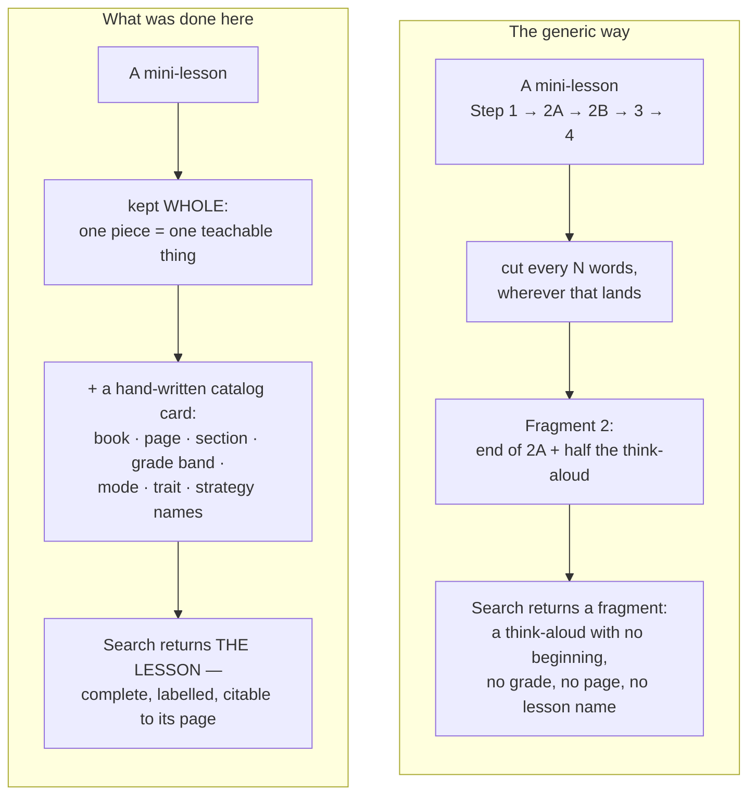
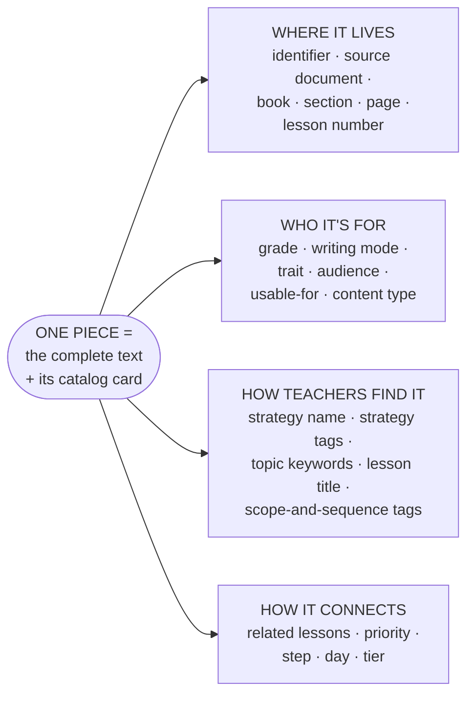

# 10 — The Knowledge Base

> This is the layer least visible in the product and most expensive to produce: converting roughly
> **1.5 million characters** of the client's teaching material into something machine-usable
> **without losing the pedagogy.**

Every figure in this chapter was measured directly from the live material.

---

## 10.1 The central decision: hand-crafted, not automatically split

Most retrieval systems prepare documents the fast way: cut the text into equal-sized blocks every
N words and let the search engine sort it out. For teaching material that is **ruinous**.



The project's own standard, verbatim:

> A piece of content *"should be a coherent pedagogical unit — a step, a skill, a strategy
> explanation — not a random paragraph split mid-sentence."*

> **The analogy that sticks: a paper shredder versus a librarian.** The generic way shreds the
> books and searches the strips. Here, a librarian read everything, filed each complete lesson
> intact, and attached a catalog card to every one.

---

## 10.2 What's in it

| Measured | Value |
|---|---|
| Source documents processed | **42** |
| Total pieces of content | **710** (~256,000 words of curated material) |
| Distinct labels per piece | **31** |
| From the K-2 Launch book | **137** pieces |
| From the 3-12 Launch book | **119** pieces |
| Pieces carrying a named-strategy tag | **226** |
| Pieces mapped into the scope-and-sequence bands | **311** |
| Pieces with a page number | **391** |
| Pieces in the live searchable index | **703** — the 710 minus 7 that describe the four-step method itself, which are **built into the model's instructions** instead |

### The twelve content types

The content-type label is load-bearing: it **changes how a piece is used**, not just how it is
described.

| Type | Count | What the system does with it |
|---|---|---|
| Course episode explanation | 223 | The client's teaching voice — the *why* behind each practice |
| **Textbook lesson** | 206 | **The primary source** — what generated lessons are built from |
| Complete lesson script | 79 | Models of full four-step delivery. *(Also given budget priority when assembling source material)* |
| Training transcript | 57 | Deep coaching question-and-answer |
| **Overview** | 50 | Pacing guides and section overviews — **deliberately never cited as "this lesson"** |
| Framework | 29 | The four-step method itself |
| Think-aloud script | 20 | Ready modelling passages |
| Think-aloud guide | 15 | How to build one |
| Standards alignment | 11 | Curriculum-standards mapping |
| **Scope and sequence** | 9 | **Promoted to the top when a teacher plans a unit** |
| Coaching language | 6 | Per-step phrasing |
| Mode taxonomy | 5 | Modes, genres and formats |

> **This is what "fitted to the use case" means concretely.** A pacing guide and a mini-lesson are
> both *text* — the system treats them completely differently **because the type tells it to.**
> Overviews inform planning but can never be served as a lesson; the scope-and-sequence leaps to
> first place only when a teacher is planning a unit.

### The labels speak the client's vocabulary, not a generic one

| Dimension | Distribution across the 710 |
|---|---|
| **Mode** | mode-agnostic 439 · Inform 154 · Persuade 79 · Entertain 38 |
| **Trait** | all-traits 343 · Ideas 190 · Organization 93 · Conventions 38 · Word Choice 20 · Sentence Fluency 16 · Voice 10 |
| **Usable for** | coaching 241 · lesson generation 235 · both 234 |
| **Grade** | K-2 172 · K-12 141 · 3-12 134 · 6-12 81 · K-5 74 · then individual grades |

The grade field speaks in **the client's bands**. The mode field speaks his three-mode taxonomy.
The trait field speaks the standard trait framework. **A generic pipeline would have labelled his
books with someone else's categories.**

---

## 10.3 A piece of content and its catalog card

All 31 labels are present on **all 710 pieces** (one exception, present on 7).



### The labels that are genuinely load-bearing

| Label | Used by |
|---|---|
| Grade | The search grade filter |
| Content type | The ranking categories **and** the never-cite-an-overview rule |
| Book + page | **Honest citations** — a page is only ever cited from here, never guessed |
| Mode + scope tags | Mode-correct lessons and unit plans that follow the scope and sequence |
| Strategy name and tags | Search expansion, and the escape hatch from the ranking sink |
| **The identifier** | **The citation contract** — it's what the model names |
| "Is a scripted lesson" | Eligibility for the top ranking category |

> ⚠️ **One "tier" label is the same value on every single piece and is not used for ranking.** The
> ranking category is computed at query time. Don't confuse them.

> ⚠️ **A priority field exists and the ranker does not read it.**

### Why the labels were audited by hand

The project's own audit manual is blunt:

> *"Content AND labels drive every downstream decision… If a piece's labels are wrong, the
> downstream cascade is wrong. Search surfaces the wrong content. Generation cites wrong pages.
> Checks false-flag good answers or miss bad ones. The client loses trust."*

So the audit's own non-negotiable rule was **"no pattern matching, no scripted diff — comparison is
semantic and pedagogical, not lexical."** Content was compared against the source documents **by
eye.**

That audit caught, among other things, that **two entire sections of one book had been missed** —
and they were hand-crafted in, growing that book's coverage from 112 pieces to 137.

---

## 10.4 The two hand-built bridges

### The strategy vocabulary

```
46 canonical strategy names → 180 spoken synonyms → 243 related-skill keywords
```

This is how *"is there a pizza table lesson?"* finds paragraphing content even though the word
"paragraph" never appears in the question.

Each record holds exactly three things: the spoken synonyms, the descriptive keywords, and where
in the books it comes from.

> ⚠️ **A strategy is a *family*, not a lesson.** One nickname is attached to **14** library entries;
> **19 of 40** name more than one. So *"is there a pizza table lesson?"* has **no single lesson to
> point at** — the right behaviour is to *explain the strategy*.

### Hand-written teacher questions

For **183 key lessons**, **1,254 realistic teacher questions** were written *by hand* — *"How do I
teach students to add interesting facts to informational writing?"* — and the lessons indexed under
them.

> This is the bridge between **how teachers phrase problems** and **how the books phrase
> solutions.** It is the least glamorous and most valuable thing in the whole knowledge base.

---

## 10.5 The 214-lesson library

A curated store of **214 complete, ready-to-teach mini-lessons** (~103,000 words of the client's
verbatim lesson text) sits *above* the general content store.

Each entry carries an identifier, a lesson title, its hand-written questions, applicable grades and
modes, scope-and-sequence tags, strategy tags, **its book and page**, a link back to the source
content, the complete lesson text, and a priority level.

By source: 94 from the 3-12 book · 89 from the K-2 book · 7 earliest-writer lessons · 24
grade-level persuasive lessons.

> Those 24 were **hand-composed** from four-column grid layouts in the source into canonical
> four-step reading order, preserving the client's verbatim teacher language — with a written
> rationale recorded per lesson for its trait assignment.

**Provenance is complete: every one of the 214 has a page number.**

> ⚠️ **But 28 entries have a page number of 4 or lower, and 24 of those are the client's own
> supplementary lessons — where those numbers are a *handout index*, not a book page.** If anything
> ever cites them, he gets a confident lie about his own materials, which is exactly what the
> stay-silent rule exists to prevent. This is a filed, open hazard.

---

## 10.6 Building the index

The pipeline:

1. **Load** all the content, **excluding** the framework pieces that are built into the
   instructions instead.
2. **Validate** every piece against closed vocabularies — grades, traits, modes, usable-for.
   ⚠️ **Validation never blocks anything.** Violations are collected and **logged as warnings**, and
   the piece is indexed regardless. *Do not read "there is a validator" as "bad labels can't get
   in."*
3. **Embed** the text in batches.
4. **Build the keyword representation.**
5. **Create the collection**, with both representations plus indexes on the filter fields.
   ⚠️ **Those indexes are no-ops** in the locally-embedded mode actually used — the local
   implementation is a warning and an immediate return. (And one of them indexes a field with
   exactly one distinct value.)
6. **Insert**, with each piece's position derived deterministically from its identifier — so a
   re-run lands on the same places. ⚠️ **A duplicate identifier therefore silently collides**: both
   map to one place, the later one wins, and there is no error and no count mismatch anyone would
   notice.

**Cost of a full rebuild: roughly 327,000 tokens — about four cents, in eight calls.** It is cheap.
**The risk is destructiveness, not price.**

### ⚠️ Rebuilding is destructive

Its own documentation says *"idempotent — deletes and recreates the collection on each run."*

**"Idempotent" here means the end state is the same, not that nothing is destroyed in between.** It
**deletes** the collection and rebuilds it. If embedding fails halfway, you have a partial index
and no backup.

> 🔴 **There was a landmine among the maintenance tools — and how it was defused is the lesson.**
> One build script selects content using a vocabulary **the corpus abandoned**, so it matches
> **zero of the 710 pieces**. It then wrote its (empty) output **unconditionally**, which would
> have **wiped all 214 library entries** — and a written plan told a future engineer to run it.
>
> **It is now safe.** A guard was added that refuses to write when a rebuild would drop entries,
> and it **fails closed before** the overwrite. The broken selector was deliberately left in place,
> with the whole history recorded in the tool itself.
>
> **The instructive part is the shape of the fix.** They did not repair the selector and call it
> done — that would have left the next such tool just as dangerous. They made the *write* refuse to
> destroy data. **Guard the irreversible step, not just the bug that reached it.**
>
> Still: **read any maintenance tool before running it**, and specifically ask what it writes when
> it matches nothing.

### Two artifacts a fresh setup will not have

Both are excluded from version control by design:

| Artifact | How it is rebuilt |
|---|---|
| The searchable index | The rebuild described above |
| The library's question index (~93 MB) | A separate build step |

> There is a **fingerprint cache** on that second one specifically so that re-writing one lesson's
> questions costs **one call rather than 1,471.**

---

## 10.7 Gotchas

1. 🔴 **You may be editing the wrong copy of the content.** The previous generation's copy is **34
   of 42 files byte-identical** to the live one. Edit the wrong one and **it looks like it worked**
   — right up until nothing changes in search results.
2. 🔴 **Two checks on the index build can never fail, and one asserts the opposite of reality.** One
   compares a field against a *filename* it can never equal. The other looks for an identifier
   prefix that **has never existed** — while **256 textbook pieces are in the live index** and the
   build's own documentation claims they're excluded. **A passing check, a stale description, and
   the truth, all disagreeing at once.** *(See Chapter 14, shapes A and B.)*
3. **The two "tier" ideas are different things.**
4. **Changing the embedding model invalidates every indexed vector.** The setting must match what
   is in the index.
5. **Rebuilding takes the same exclusive lock as the running engine** — stop it first.
6. **The framework pieces are deliberately excluded.** If you count and get 703 instead of 710,
   that's why.
7. **One label is present on every stored piece but absent from the in-memory representation** — so
   a ranking branch that guards on it is permanently dead.
8. **The library's question-index builder would strip its own model and fingerprint records** — its
   documentation claims a field it doesn't write — forcing a full **1,471-call** rebuild next time.
9. **Three content-mutating tools have no dry-run mode.**
10. **The low-page-number hazard** (§10.5) is real and open.

### The reassuring part

Independently verified: **the live index has zero drift** against the source content, the **library
has zero drift** against the pieces it was derived from, and the question index has **zero stale
and zero orphaned entries** across 1,471 embeddings.

**The data layer is in good shape. It is the tooling around it that carries the traps.**

---

## 10.8 Check yourself

1. Why would automated fixed-size splitting have been actively harmful here — not merely
   suboptimal?
2. A pacing guide and a mini-lesson are both text. Name three places where the system treats them
   differently, and the single label that drives all three.
3. Where does a cited page number come from, and what happens when it's absent?
4. One strategy nickname maps to 14 lessons. What does that imply about the question *"which lesson
   does the teacher mean?"*
5. You need to rebuild the index. What must you stop first, what is destroyed in the process, and
   what do you have if it fails halfway?

---

**Next:** [11 — How It Is Verified](11-testing-and-verification.md)
