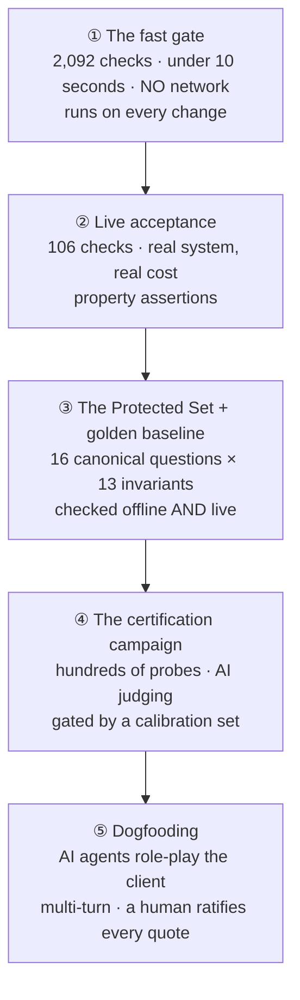

# 11 — How It Is Verified

> **The verification machinery is bigger than the product.**
>
> ~17,600 lines of application logic · **~27,300 lines of automated checks** · ~5,900 more of
> verification harnesses · plus 242 supporting artifacts — recorded claims, hand-labelled answer
> keys, conversation briefs, transcripts, verdicts.
>
> That ratio is the single most important thing to understand about how this team works.

The product is driven by a language model, so almost nothing it produces is repeatable
word-for-word. You cannot compare a generated lesson against a stored copy. So the team built a
five-layer pyramid.

---

## 11.1 The five layers

| Layer | Guarantees | Run when |
|---|---|---|
| ① Fast gate | Deterministic logic, **the content of instructions**, and **delivery wiring** | Every change |
| ② Acceptance | Properties of real answers from a running system | At milestone boundaries |
| ③ Protected Set | The named behaviours that must never regress | Every milestone, both offline and live |
| ④ Campaign | Per-requirement alignment, at scale | Certification pushes |
| ⑤ Dogfooding | Whether it holds up in a real multi-turn conversation | Before the client tests it |

---

## 11.2 Layer ① — the fast gate

**Measured: 2,092 checks passing in under ten seconds.** No exclusions, no skips.

**It needs no network** — verified empirically by re-running with deliberately broken credentials
and all outbound traffic pointed at a dead port. Every model call in this layer is substituted.

It pins **three different things**, and it matters that you can tell them apart:

| Kind | Example |
|---|---|
| **Pure logic** | Ranking properties, name normalisation, band arithmetic, retry backoff, history trimming |
| **Instruction content** | That a specific rule literal is actually present in the **assembled instruction** for a specific answer type |
| **Delivery wiring** | That a value computed while producing an answer **survives to the payload actually sent** |

That third kind exists because of the delivery switch. One check walks *every* fixed output string
in the lesson path and fails if one reaches the prose form but not the delivered payload — with the
fix instruction written into the failure message.

> The certification harness is itself covered by this gate — 84 checks. **The verifier gets
> verified.**

---

## 11.3 Layer ② — live acceptance

**106 checks** that talk to a running system: generation, the protected baseline, understanding,
retrieval, multi-turn memory, and conformance. The understanding checks are separately gated so
routine runs never spend money.

### How it copes with non-determinism

**Property assertions, never exact text.** The helper library *is* the answer:

| Helper | What it actually asserts |
|---|---|
| Top-source check | A **pattern** over the top **three** sources — not an exact identifier, not just the first |
| Depth check | A **word-count ratio**, with the multiplier **imported from the shipped rule** so the check tracks production instead of a hand-typed number |
| Monologue check | **At least two of a set** of phrases — a threshold, not a required sentence |
| Ending check | A phrase **anywhere in the last 500 characters** — not a literal ending |
| Citation check | **Conditional** — only fires if a citable source was used, and reuses the stripper's own pattern *"so this assertion can never demand a page format the stripper would remove"* |

**The exceptions prove the rule.** Exact matching is used only where the client specified verbatim
wording, or where the string is a **fixed template** — and in that case the check says so and
**imports the template** rather than retyping it.

The conformance checks go further still and assert using **the product's own production rule
checks** against live output.

---

## 11.4 Layer ③ — the Protected Set

A **protected invariant** is a named, machine-checkable property of a whole answer that must hold
for a canonical question. Not *"the answer equals X"* but:

- "this answer is a complete five-part lesson"
- "Step 2B is at least three times Step 1 and contains first-person language"
- "no raw internal marker is visible to the teacher"
- "an answer for an older grade does not cite the younger-grade book"

**16 canonical questions × 13 invariants.** The questions are data; the checkers are logic; **three
layers consume them**:

| Layer | What it does |
|---|---|
| **0 — well-formedness** | Enough cases, unique names, every referenced invariant exists. Offline |
| **1 — the offline golden gate** | Runs every checker against a **recorded snapshot** of real answers. A checker that used to pass and now fails is a regression. **A case missing from the recording is a hard failure**, so adding a case without re-recording fails immediately |
| **2 — the live golden master** | Re-runs the same checkers against a running system, sending the setup turns first to build the conversation state |

### The self-expiring quarantine

One mechanism deserves copying. A single **(question, invariant) pair** — never a whole question,
never a whole invariant — can be excused when the recording predates a fix. Two things keep it
honest:

1. A misspelled entry is rejected.
2. **If a quarantined pair starts passing, the check goes red demanding its deletion.**

> *"A quarantine that outlives its cause is a hole in the gate."*

### The set names its own blind spots

Two of the thirteen invariants were added late, and the note is worth reading: until they existed,
the set was **citation-blind** — thirteen properties, none about the book or page an answer points
a teacher at. So every *"zero new regressions"* claim made across **three consecutive citation
projects** was **structurally incapable of failing on the one dimension that work changed.**

> **"A live gate that cannot fail on the thing being changed is not a gate."**

---

## 11.5 Layer ④ — the certification campaign

Four deliberately independent stages: **drive → judge → calibrate → verify**, each testable on its
own.

**A claim** is the unit of certification: a client rule in one sentence, where in his own materials
it comes from, how it should be judged, how important it is, the conversations that exercise it,
and the rubric.

Importance drives both the sample size and the pass threshold — safety-critical rules get the most
probes and **zero tolerance**.

### Four design choices worth learning

**1 · Never lie about failure.** The driver retries with backoff and jitter, and on exhaustion
returns an explicit **"no verdict"** result — it **never throws**, and a no-verdict result is
**never scored**. An unrecognised judging method returns **"uncertain"** — not a crash, and
**crucially not a silent pass**.

**2 · Every exchange is recorded**, so a later re-judging never re-runs the conversation. That is
what made it possible to re-adjudicate a dozen contested verdicts later without paying the driving
cost again.

**3 · The calibration gate blocks the run.** Before any real probe, the judge is measured against a
hand-labelled answer key. **The tolerance for wrongly certifying a known-bad answer is zero** — if
the judge passes even one, the campaign halts.

> The asymmetry is deliberate: a lenient judge **certifies a defect**, which is the failure that
> matters. A strict judge merely creates work.

**4 · Multi-turn probes must carry their setup.** Earlier turns are attached to the judged answer —
because a re-run once scored a *correct* two-turn exchange as a violation at 0.95 confidence
**purely because turn one was invisible to the judge** — and scored it correct at 0.9 once it
wasn't.

> **Wrong in both directions.**

---

## 11.6 Layer ⑤ — dogfooding

AI agents **role-play the client** having real multi-turn conversations; other agents analyse whole
transcripts; a human ratifies every quote against the transcript.

- One driving primitive: send a turn, record the full exchange, print the reply. **Capture only —
  it never judges.**
- Conversation briefs are schema-validated, so an under-specified conversation is rejected
  **before** it is run.
- **Coverage gates fail if any requirement is exercised by zero conversations.**
- **A calibration phase runs first**, and the whole run aborts if the analyst grades the sample
  transcripts wrongly.
- The analyst's brief says, in as many words: **"You CAN and MUST fail things. An all-passing
  report is a red flag."** It also has a mandatory **"not applicable"** verdict so it can decline
  rather than manufacture a pass — and the calibration set includes a case proving it will.
- The harnesses have **their own checks** — 39 of them, including checks on the *briefs* given to
  the agents.

---

## 11.7 The testing philosophy — three rules the team enforces on itself

### 1 · Property assertions, never exact text, for model output

Covered above. The principle is stated outright in the ranking checks: *"assert ordering
**properties**, not specific boost values — each case builds two pieces of content differing in
exactly one attribute, so the principle holds regardless of the exact coefficients."*

### 2 · Instruction-content checks paired with behavioural checks

> A rule that lives in a model instruction has a unique failure mode: **delete it and nothing breaks
> loudly.** The model simply stops doing the thing — forever, silently, with everything still
> passing.

So this system asserts on the **assembled instruction** as well as on behaviour. The clearest
statement of the doctrine, verbatim:

> *"The earlier plan's instruction checks all passed with its attribution rule DELETED. With no
> rule, the model leaves the field empty forever, the citation silently vanishes from every answer,
> and the gate stays green. … So every rule assertion below is a VERBATIM literal asserted against
> the ASSEMBLED instruction of EACH answer type. **Not the shared constant** — a constant on both
> sides of a containment test cannot fail against a rewording, because it moves with the assertion.
> And **not a keyword**, which survives the imperative being reworded away. **Deleting the rule AND
> weakening it both have to go red.**"*

The pairing is deliberate:

> **The instruction check says *we told the model*. The behavioural check says *the model did it*.
> Neither alone is sufficient** — an instruction check alone certifies an order nobody follows; a
> behavioural check alone goes quietly green when a rule erodes and the model happens to comply
> anyway.

And there is a third kind for **delivery** — because a rule can be correct, present in the
instruction, honoured by the model, and *still* never reach the teacher.

### 3 · The failure mode this team hunts: the check that cannot fail

> A check that **cannot fail**, or **cannot pass**, or **manufactures its own input**, is worse than
> no check — because it converts *"we have no coverage here"* into *"we verified this."*

Roughly a dozen instances are on record, and the checks now carry the post-mortems inline.
**Learn the four shapes:**

#### Shape A — the tautology (a check built from the thing it audits)

The "no raw marker survives" invariant audits the marker-removal pass. It must **not** be written
using that pass's own pattern — *"the sweep removes precisely what the sweep matches, so such a
check passes by construction on every answer the sweep touched."*

It is therefore a plain substring test, **deliberately wider than both production patterns** — wide
enough to catch a mangled identifier and a marker with no closing bracket. Two checks exist purely
to prove that width, and **each names the mutation it kills.**

#### Shape B — the vacuous pass (a check that never engages)

Three real instances:

- The two citation invariants would have passed **vacuously on all nine lesson cases** if written
  against the five steps instead of the whole delivered payload — because the citation ships
  elsewhere in it.
- Emptying a shared rule constant left an instruction check **green**, because *"contains nothing"*
  is true of every instruction. *(Found by mutating the check's own constant.)* The fix pins the
  constant to a real rule before the assertions run.
- A history-trimming check built far fewer turns than the actual limit, so **trimming never fired**
  and every assertion was vacuous. The fix builds enough turns *and* asserts *"trimming must have
  actually dropped turns."*

#### Shape C — the manufactured input (the pipe with no water)

Verbatim from the check that now guards it:

> *"The offered list was declared on the reader and named in the model instruction but NEVER
> populated by production code — its only writers were a check and a sample, so a passing check
> manufactured the value and asserted the renderer forwarded it. **A pipe with no water.**"*

The consequence was the campaign's worst product defect. The repair pattern is now house style: the
first group of checks drives the **real production path** and asserts production populates the
value, and a companion check asserts the renderer **ignores** a manufactured one — so there is only
one home for the data. **The old manufacturing check was corrected, not restored, and its
tombstone left in place.**

#### Shape D — the rubric that could never PASS (the mirror image)

One claim's rubric looked for step labels in a rendering that **never emitted them** — zero out of
five on every sample. Its ten-out-of-ten "violation" verdict was a pure harness artifact; the
feature had shipped since the very first version. On the same page, another judge quoted a header
that **exists nowhere**, at 0.98–1.0 confidence.

> **The blindness cuts both ways — a check that cannot fail hides real defects; one that cannot
> pass manufactures fake ones.**

---

## 11.8 How the hunt is operationalised

Concrete, copyable practices:

| Practice | Why |
|---|---|
| **Every gate check names the mutation it kills** | *"A check that passes against a broken implementation is worse than none."* |
| **Mutation-test your own check** | The empty-constant bug was found by mutating the *constant*, not the logic |
| **Explicit non-vacuity anchors** | Files sharing a fixture add one check whose only job is to prove the fixture *can* trigger the behaviour |
| **Assert the FAIL direction, not just the pass** | *"An invariant only ever asserted in the passing direction is a decoration."* Feed the checker a deliberately broken answer and assert it fails |
| **"Cannot determine" must read as FAILURE** | One invariant refuses to shrug when it can't work out the grade band — the mutation it kills is literally *"if unknown, return true"* |
| **Build fixtures from the real producer** | *"A hand-written citation is a RECONSTRUCTION… if the title table and the patterns drift apart, the checker goes vacuous while a reconstruction-fed check stays green and certifies the vacuity"* |
| **Confirm a value is populated before trusting a check that reads it** | The inert-field class: **zero of 9,942** recorded sources ever carried the field one analysis lens was told to examine |
| **Independence over reuse in the verifier** | The judge keeps its own copy of a classifier **so the verifier cannot inherit the bug it is hunting** |
| **Turn a past miss into a check that can fail** | A coverage gate exists because one campaign had a requirement exercised by **zero of 66** claims |

### The one-line version

> **Before you trust a passing check, ask whether it could ever go red — and whether it could ever
> go green.**

---

## 11.9 Things to know before you interpret a result

- **The live acceptance harness still defaults to the wrong network address.** It must be told
  where the running system actually is. The project's own notes call this "resolved" — it is
  resolved for the front end, **not** for this harness.
- **Vary the caller identity when driving automated conversations.** A sweep under one identity
  produced **54 rate-limit rejections** that were initially read as **28 behavioural regressions.**
- **Two declared test categories are entirely empty**, despite having reserved labels.
- **Freeze all changes during a live measurement.** A parallel change landing mid-run invalidates the
  numbers even when the production behaviour didn't change — the same family as measuring a system
  that hasn't been restarted since your edit.

---

## 11.10 Check yourself

1. The fast gate runs 2,092 checks in under ten seconds with no network, yet it covers citations,
   source ordering, and exact closing questions — none of which are deterministic in production.
   **What is each of those checks actually pinning, and which layer picks up the part it cannot
   see?**
2. Why would implementing the grade-band citation invariant against only the five steps have
   produced a check that **passed on all nine lesson cases while an older-grade answer cited the
   younger-grade book**?
3. The campaign halts if the judge wrongly certifies even one known-bad answer, but never halts for
   being too strict. **Why is the gate deliberately asymmetric?**
4. You add a new canonical question to the Protected Set. **What fails, in which layer, and what is
   the sequence to get back to passing?**
5. Name the four shapes of a check that cannot fail, and the single question that catches all of
   them.

---

**Next:** [12 — How It Runs in Production](12-running-and-ops.md)
