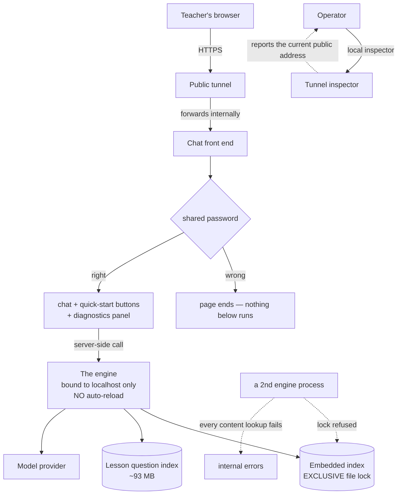

# 12 — How It Runs in Production

One machine. Three processes. No containers, no reverse proxy, no continuous deployment, no
staging environment. **Several of the constraints below are direct consequences of that.**

---

## 12.1 The topology

**The teacher's browser never talks to the engine.** The front end calls it server-side — which is
why the engine can stay bound to the local machine.

### The three processes

All run as **unprivileged, user-level services**, started automatically at boot, restarting on
failure. **No administrative rights are required anywhere.**

| Process | Role |
|---|---|
| The engine | Serves the one chat operation |
| The front end | The teacher-facing chat interface |
| The tunnel | Exposes the front end on a public address |

> ⚠️ **The public address is from a free tunnelling tier: it changes every time that process
> restarts** — and because it restarts automatically on failure, **a crash silently hands the
> client a dead link.** There is no fixed domain and no monitoring. If the client reports a dead
> link, get the current address from the local inspector and re-send it.

---

## 12.2 What it takes to run

Conceptually, four things must be in place:

| Requirement | Notes |
|---|---|
| **Credentials for the model provider** | The only strictly-required secret. Its absence stops the process at startup, deliberately and loudly |
| **The searchable index** | **Not distributed** — it is built from the source content locally |
| **The lesson question index** | Also built locally; ~93 MB |
| **The front-end password** | Without it the interface shows an error instead of a login prompt |

> **Neither index is shipped**, so a fresh environment has neither and must build both before the
> system is useful. The build is cheap — a few cents — but see [Chapter 10](10-knowledge-base.md)
> for why it is also **destructive**.

The engine must be started **from the right working directory**, because several configured
locations are relative to it. See trap 5.

---

## 12.3 The traps that will bite you

### 1 · 🔴 Only ONE engine process may exist

The embedded index takes an **exclusive, non-blocking lock** on its folder. A second process
opening it is refused outright.

**The nasty part is *when* it fails.** The connection is established lazily, so a second engine
**starts fine, binds its port, and reports itself alive** — it only fails on the first *content
lookup*, which becomes an internal error. And because the connection is never successfully
established, **every subsequent lookup repeats the failure.**

> **Symptom to recognise:** greetings and clarifying questions work perfectly; **everything that
> needs content fails.**

The same trap applies to rebuilding the index while the engine is running, and to running the
engine with multiple worker processes.

### 2 · 🔴 The engine does not reload on change

Editing anything changes **nothing** that is running. **Restart before you observe behaviour.**

> A measurement taken against a not-yet-restarted engine has produced a **wrong verdict** in this
> project's history. If you are unsure, compare when the process started against when you made your
> change.

### 3 · An *empty* value for the provider's base address poisons the client library

The library reads that setting directly and honours an empty string as *"use an empty address"* —
producing a protocol error on the very first call. There is a defensive scrub that removes the
setting when it is blank, but only for paths that load configuration first.

**Never set it to an empty value.**

### 4 · A stale credential in the surrounding environment silently overrides the configured one

The process environment takes priority over the configuration file. **This is live on the working
machine**, not hypothetical. Start interactive runs with that variable explicitly cleared. The
managed services are immune, because their environment contains no such variable.

### 5 · A wrong working directory fails in **two different ways**

- With a clean environment: startup fails with *"missing required secret"* — because the
  configuration file is looked up relative to the working directory.
- **Worse:** if the credential happens to be present in the environment, the process **starts
  successfully** from the wrong place, and the loader for the four-step methodology rules logs an
  error and returns the literal string *"(framework rules unavailable)."*

> **The system then generates lessons with no methodology rules at all.** The readiness probe
> catches the index half of this. **Nothing catches the instruction half.**

### 6 · The whole public deployment shares ONE rate-limit bucket

The limiter is keyed on a caller identity, and the front end sends **the same constant for every
user**. No override is configured, so the default **50 requests per hour applies to all teachers
combined.**

### 7 · Sessions live in memory — restarting silently erases every open conversation

The browser keeps its session identity across a restart, so the teacher's page looks unchanged
while the engine starts a brand-new empty conversation. **Never restart mid-demo.**

### 8 · Shell aliases can hang automation

On the working machine, the copy and remove commands are aliased to prompt for confirmation, so
they **wait for an answer nobody gives.** One automated restore step hung for 59 minutes and looked
like a stuck process. Force-bypass those aliases in any script.

---

## 12.4 The front end

A password-gated chat interface. **Not the final product** — it is the client's evaluation surface,
and its **diagnostics panel exists so he can see *why* the assistant said what it said.**

**The flow:** password gate → *(if it fails, the page simply ends and nothing below runs)* → a
session identity minted once per browser session → quick-start buttons before the first message →
chat input → a server-side call → render.

**Rendering a lesson**, in order: the one-skill note → title → header caption → the five steps
*(skipping any that are empty)* → the citation → the follow-up question last. Plus a "copy as
markdown" option.

A caption line shows the quality mark, the model, and the **first eight characters of the
correlation id** — the same id the engine logs, so a bug report can be traced straight to the
right log entries. **That is a genuinely good piece of design.**

**Its own rule, worth noting:** the header display prefers the engine's computed header and
otherwise falls back to **grade only** — with an explicit note never to synthesise a writing mode
from the model's own guess. **The front end upholds the same rule as the engine.**

It has its own automated checks — 20 of them, all passing.

### ⚠️ The diagnostics panel lies in three ways

| What it shows | Reality |
|---|---|
| Six "session memory" rows | Read from names the engine **never sends** — leftovers from the previous generation. Permanently blank, including, ironically, the offered list |
| Every source's relevance, shown as `0.000` | The value is **hardcoded to zero**; the type column is blank for the same reason |
| "Specificity: broad" | **Hardcoded** |
| An "ungrounded terms" panel | Can never appear — the value is always empty |

> **Do not read the panel as evidence that the engine "lost" something. It never had it.**

---

## 12.5 Security — the honest picture

This is not a lecture; it is what an engineer joining needs to know is **true today**.

| Fact | Consequence |
|---|---|
| **There is no authentication on the engine.** No token, no identity, no gate | The only protection is the front-end password. The engine is safe today only because it binds locally and only the front end is exposed — **a network accident, not a control** |
| The front end runs with **cross-site protections disabled**, exposed through a public tunnel | Behind nothing but one shared password compared directly |
| One shared password, no user identity | No lockout, no per-teacher audit trail |
| **The front-end password is stored in version control** | |
| **An operations document contains both the password and a live credential inline**, and is also in version control | This file is a **security artifact to be scrubbed**, not documentation |

> 🔴 **This is why credential rotation sits at the top of the backlog.** See
> [Chapter 15](15-current-state-and-roadmap.md). The decision on record was *"expose now, rotate
> later"* — and the second half has not happened.

**The rule for you:** never put a secret into code or documentation. Reference **where** it lives,
never **what** it is.

---

## 12.6 Dead knobs and stale descriptions

- **Several settings have no effect whatsoever** — including a message-length cap that is actually
  enforced elsewhere at a fixed value. Setting them changes nothing.
- **The example configuration still advertises the previous generation of models** as the defaults,
  and documents a cache server and an authentication secret — **neither of which exists anywhere in
  the system.**
- **The configuration claims the test runner sets a validation-skip flag automatically.** It does
  not. **Nothing sets it.** The fast gate passes today only because a real configuration file
  happens to be present; in an environment without one, the entire suite would fail at startup.
- **The front end's own checks mis-describe themselves** — a note explains that the interface
  module cannot be imported under the test runner, and then six checks in the same file import it
  successfully.
- **The operations document is wrong in every operational fact**: the process manager, the
  directory, the port, the reload behaviour, the network binding, where logs go, and the public
  address.

---

## 12.7 Check yourself

1. You start a second engine to "test something on another port." It reports itself alive and
   greetings work, but every lesson request fails. What happened — and why did the failure not
   appear at startup?
2. You change a rule, then immediately observe live behaviour. Why might your result be
   meaningless?
3. You start the engine from the wrong directory and it comes up fine. What is silently broken, and
   which health probe would **not** catch it?
4. A teacher says the assistant "forgot everything mid-conversation" and there was no error. What
   is the most likely cause?
5. The diagnostics panel shows a relevance of `0.000` for every source. Is retrieval broken?

---

**Next:** [13 — How This Team Works](13-ways-of-working.md)
