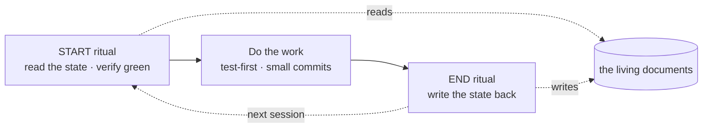
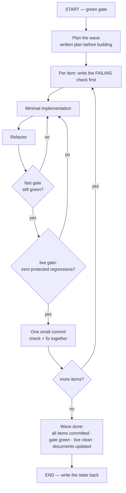

# 13 — How This Team Works

This chapter is about process, not mechanism. It matters more here than on a typical project,
because most of the process exists to prevent one specific failure mode ([Chapter 14](14-hard-won-lessons.md))
— and because much of the engineering happens in long working sessions where **written state is the
only thing that survives**.

---

## 13.1 The core idea: the project remembers, not the people

Work happens in sessions. Between sessions, nothing is in anyone's head. So the project keeps a
small set of **living documents** that are read at the start of every session and updated at the
end of every session. They are not archives — **they are working memory.**

### The documents

| Document | What it holds | How often it changes |
|---|---|---|
| **The hub** | Points at everything else, plus a running summary of current state. Loaded automatically at the start of every session | Every session |
| **The session log** | Newest first. What shipped, what's next, what broke | Every session |
| **The delivery tracker** | Every work item with its status, plus the recorded verification counts | Every session |
| **The backlog** | What to work on next, grouped now / next / later | Every session |
| **The strategy** | The north star: ground rules, the safety-net design, sequencing | Rarely |
| **The decision record** | Why we chose things | On decisions |
| **Open questions** | Unresolved questions — **and withdrawn ones, with why** | As needed |
| **Client requirements** | Each traced to the client's own words, with an honest status | On client contact |
| **Client comms** | What is owed back, and **what must not be claimed yet** | On client contact |
| **Conventions** | The working agreements below | Rarely |
| **Running notes** | Gotchas — the "this bit me" file | As encountered |

> **Read the open questions even though the file is short.** Half its value is the **withdrawn**
> entries, which record questions that turned out to rest on the team's own errors. That file is a
> graveyard of good intentions, and it is instructive.

---

## 13.2 The two rituals

### The START ritual — before any work

1. **Research.** Read the hub, the strategy, the tracker, the latest session entry, the open
   questions, the backlog, the requirements.
2. **Check the ground.** Look at what changed recently, and whether anything landed *after* the
   most recent session entry — that means a previous session ended without writing its state, and
   there is unlogged work to reconstruct.
3. **The green gate — evidence, not trust.** Actually run the fast verification suite and compare
   the result against the count the previous session **recorded**.

   > **Green *and matching* → proceed. Red *or mismatched* → STOP and fix it before any new work.**
   > The gate never trusts a written claim — because a written claim is exactly what this project
   > has repeatedly found to be wrong.

4. **Report the state**, and wait for confirmation before starting.

### The END ritual — before stopping

Write everything back: update the tracker with what was completed, record each verification layer's
status **honestly** (did the fast gate pass? was the live layer run? is anything red or deferred?),
write the session entry, update the backlog, and **loudly flag anything incomplete** so the next
START gate catches it.

---

## 13.3 The working agreements

Treated as hard rules.

### Engineering

- **Verification before completion.** Never claim done, fixed or passing without running the check
  and showing the result. *Evidence before assertions.*
- **Production-grade, not patches.** No shaping a fix around a failing check. Fix the general case.
  If the same bug can occur at three places, fix the seam, not the three places.
- **Explain before implementing.** Plain English first; agree the approach before building.
  Diagnose the root cause → propose the *simple, general* fix → explain it simply → then build.
- **Honest reporting.** Distinguish confirmed from uncertain. Don't call a partial win "resolved."
  Treat a borderline result as a **possible regression** until probed repeatedly.

### Change management

- Small, frequent commits — ideally **one finding = one commit containing its check and its fix
  together**.
- Verification passes before you commit.
- Each change carries its requirement identifier, so **requirement → implementation → check** stays
  traceable.
- Larger or experimental work goes on a branch.
- **Publish only when asked.**

### Security — hard rule

- **Never commit a secret.** Not in code, not in documentation, not in these notes. Reference
  **where** a secret lives, never **what** it is.
- The project has a live, unpaid debt here: credentials reached published history and rotation is
  still owed. See [Chapter 15](15-current-state-and-roadmap.md). **Don't add to it.**

### Documentation

- Keeping the living documents current **is part of the work**, not an afterthought.
- The hub stays a hub, not an archive.

---

## 13.4 How a piece of work actually flows

Delivery is organised into **waves**. One wave per session; a wave isn't finished until its
definition of done is met, and that unlocks the next.

### The loop, adapted by kind of work

Not every change can be verified the same way. The strategy names five recipes:

| Kind | Example | Recipe |
|---|---|---|
| **A — Deterministic logic** | rule checks, filters, ordering, normalisation | Classic test-first |
| **B — Instruction / generation** | a new rule the model must follow | **Two parts**: a check that the assembled instruction *contains* the rule, **plus** a behavioural property checked live. Never an exact-text match |
| **C — Search / data** | ranking, categories, labels | Run real search offline against recorded query vectors — repeatable, no network. Judge quality live |
| **D — Interface** | buttons, layout | Assert the structure, plus one manual visual check |
| **E — Operations / security** | credential rotation | Not test-first — a written procedure with a verification checklist |

### Definition of done

**Per item:** failing check written first → implemented → gate green → refactored → one commit
carrying the requirement identifier.

**Per wave:** every item committed · the fast gate fully green · the live golden master showing
**zero protected-behaviour failures** · the living documents updated · anything deferred logged
explicitly.

> Text drift against the live baseline is **reviewed**, not automatically failed — model output is
> non-deterministic. **Invariant failures *are* failures.**

---

## 13.5 Working with delegated agents

A lot of the implementation here is done by dispatching parallel agents — one per independent task
— and reviewing their work. Two conventions matter:

- **Every agent runs on the strongest model available.** This work is judgment-heavy, and cheaper
  models produce plausible-looking wrong analysis, which is **the most expensive kind.**
- **The brief is where the bugs are.** Across two sessions, **19 checks that could not fail** were
  caught — and nearly every one was caught by *the agent executing the brief*, not by the person
  who wrote it. **Write briefs that invite pushback, and take it seriously when it comes.**

---

## 13.6 The environment gotchas that will bite you on day one

All of these are real and recorded:

| Gotcha | Consequence |
|---|---|
| The engine **does not reload on change** | Any observation after a change measures the **old** behaviour until you restart. This has caused a wrong verdict |
| **Only one engine at a time** — the index folder is exclusively locked | A second instance makes every content lookup fail, *after* appearing to start healthily |
| An **empty** provider address poisons the client library; a stale credential in the environment **overrides** the configured one | Confusing authentication failures, or silently reaching the wrong endpoint |
| Shell aliases prompt for confirmation on copy and remove | Scripts hang waiting for an answer nobody gives — one hung 59 minutes |
| The rate limit is **per caller identity** | An automated sweep under a single identity produced **54 rejections** that were read as **28 regressions** |
| **Freeze changes during a live measurement** | A parallel change landing mid-run invalidates the numbers even when behaviour didn't change |

---

**Next:** [14 — The Hard-Won Lessons](14-hard-won-lessons.md)
