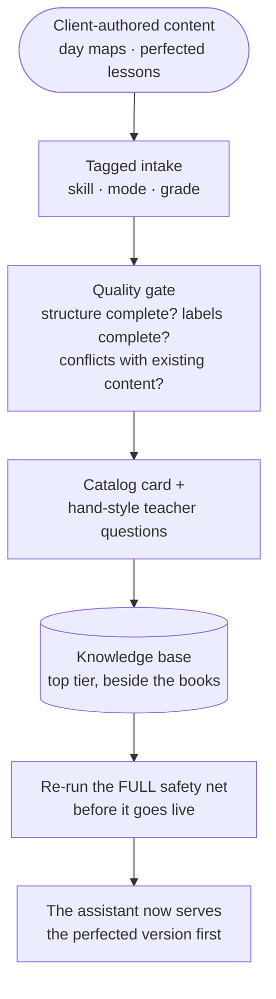
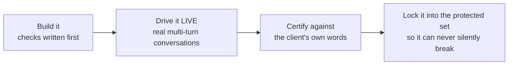

# 15 — Current State and Roadmap

*State established by running the verification suite and inspecting the live deployment directly.
Where a fact comes from a document rather than a measurement, it says so.*

---

## 15.1 Where the project stands

| Dimension | State |
|---|---|
| **Deployment** | **Live and public.** Three services running, all healthy, reboot-safe, auto-restarting, requiring no administrative rights |
| **Who's using it** | The client, for evaluation, behind a password gate at a public address. **Not** yet embedded in their course; **not** yet in front of real teachers |
| **Fast verification** | **2,092 checks passing, none failing, in about ten seconds.** Matches what the previous session recorded |
| **Published state** | Everything committed and published; nothing outstanding |
| **Working state** | Some uncommitted material, but nothing in progress: leftovers from the previous generation, plus a handful of documents from a session that ended without writing its state |
| **Client sign-off** | **Not obtained.** Everything marked "shipped" below means *implemented and internally verified*, which is not the same thing |

---

## 15.2 The requirement ledger

The client's asks are tracked as **seven "non-negotiables"** (things that were broken and had to be
fixed) and an **eighteen-item punch-list**.

### The seven non-negotiables — all marked accepted by the client

| # | Requirement | Note |
|---|---|---|
| 1 | **The client's books first — "always, always, always"** | Enforced by an absolute ranking category, not a score bonus |
| 2 | A four-step lesson with a deep think-aloud | Depth enforced by length ratios |
| 3 | Step 3 uses the exact required phrases | All four required by an automated check |
| 4 | Session memory — never re-ask what was said | Independently re-earned: a sweep of **325 sessions / 1,365 turns** found **zero lost grades and zero re-asks** |
| 5 | Never use the banned words; always explain the strategy | The cleaning pass is wired on the live path |
| 6 | Correct answer shape and closing question per request type | |
| 7 | A named lesson must be pulled, never invented | **Was genuinely violated** — 5 of 19 named lessons were answered without the named lesson in front of the model at all. Now **0 of 19**; the named lesson is present **19 times out of 19** |

> Numbers 4 and 7 are worth reading closely. **Both were marked accepted, and both later turned out
> to be partially broken.** That is not a paperwork failure — it is the single best argument for the
> verification machinery in [Chapter 11](11-testing-and-verification.md).

### The punch-list

**Implemented and internally verified, awaiting client acceptance:**

| Requirement |
|---|
| "Details" not "reasons" — vocabulary enforced by grade and mode |
| "Story" only for narrative writing |
| The grade-band closing lines |
| Lessons always in paragraph blocks, never one wall of text |
| Numbers only for true sequences; otherwise bullets |
| The current-generation model as the default |
| Student-subgroup acronyms, asking the writing level, repeating the stage per skill |
| A cluster of smaller fixes: the export flow, a duplicate-question fix, capitalised titles, emotional validation, the one-skill guard |

**Not finished:**

| Requirement | Honest status |
|---|---|
| **Multi-day lesson series** (one skill across 2–4 cumulative days) | **The engine works** — live-verified three times out of three, and the client's own note on a day-3-to-day-4 sequence was *"THIS IS PERFECT!"* **But only structurally.** Nothing verifies that what each day teaches is the right *next* thing; that progression is currently the model's inference from the books, **not the client's pedagogy.** He has offered his per-skill day maps. **They are the one true outstanding client dependency.** |
| **Procedure and management lessons** | Three distinct gaps: (a) recognising *procedure* versus *skill* as a classification, (b) a "one sentence per day" plan for the first weeks, (c) a header that says "Procedure" and carries **no writing mode**. **The four-step-lesson-from-a-procedure engine already works** — the client said so himself. **Not blocked on him**: his own book supplies the day-by-day skeleton, and he explicitly delegated the label choice |
| **The source loop** — his own perfected lessons become top-tier source | Designed, not built |

### Known live gaps that are not requirements

Real, small, and none of them blocks a demonstration:

- **Exact-page follow-ups.** *"What page is that on?"* currently **stays silent** rather than risk a
  wrong page. Never wrong — but not yet what he asked for. Needs the cited source carried across
  turns.
- **A phrasing sensitivity in routing.** An indirect *"Is there an X lesson? Can you give it to
  me?"* hedges into coaching, where the direct imperative pulls the real lesson correctly.
- Five minor items from the last full review.

### Newly surfaced, not yet triaged

Found while writing this handbook, and not previously recorded anywhere:

1. **The flagship lesson path labels its content request slightly differently from what the search
   layer checks for** — so it silently gets the *coaching* result count and **no content-mode filter
   at all**. The other answer types label it correctly. Nothing pins the value.
2. **Detection of "is this from the client's books?" is running entirely on a fallback** — its
   primary check matches **zero of 703 pieces of content**, because the content abandoned the
   vocabulary that check still uses. The same dead vocabulary also breaks a book-title lookup.
3. **An entire pending-question mechanism is inert** — several types, a rendering function, and a
   whole instruction section that can never appear.
4. **A repair module of a couple of hundred lines, with a similar weight of checks, is not wired
   in.** Its only caller is a check.
5. **Two checks on the index build cannot fail, and one asserts the opposite of reality.**
6. **The entire public deployment shares one 50-per-hour rate-limit bucket.**

---

## 15.3 The one urgent item: credentials

> 🔴 **This is the top of the backlog and it is genuinely overdue.**

Three secrets are known to have reached published history, and the product is now publicly
reachable:

1. The **model provider credential**
2. The **front-end password** — which is also stored in version control directly
3. A **source-control access token** pasted during a working session

The decision on record was *"expose now, rotate later"* — taken deliberately to get the client
testing. **The second half is still owed.** Rotate, restart the two affected services, then publish.

Scrubbing the history is optional after rotation. **Rotation is not.**

---

## 15.4 The proposed next phase

The client's feedback split cleanly along his own colour code: one colour marked **refinements of
existing behaviour** (built, live), the other marked **new capabilities that have never existed in
any version.** The next phase is that second half, scoped as four deliverables.

| # | Deliverable | Headline outcome | Needs from the client |
|---|---|---|---|
| **a** | **Series grounded in his day maps** | A full multi-day series in one request, each day a complete four-step script that builds on the previous, following **his** progression | **His day maps** — the one real dependency |
| **b** | **Procedure and management lessons** | Procedure-versus-skill recognition · one-sentence-per-day plans · the mode-free header | Only a label decision |
| **c** | **The source loop** | He feeds perfected lessons back as top-tier source, safely, himself | Two or three sample lessons as format examples |
| **d** | **Production hardening** | Exact-page follow-ups · the course embed · durable session storage | — |

**Deliverables (a) and (c) turn out to be the same pipeline** — day maps and perfected lessons are
both client-authored content entering the knowledge base through one intake, with the same problems
to solve:

The genuinely hard parts are not the upload. They are: **precedence** (when his perfected lesson and
the book's original cover the same skill, which wins — always his? only for that grade band? That is
a rule to design together, not a default to guess), **honest citations** for content that has no
book page, and **proving each addition broke nothing** — because new source material can shift what
search returns.

### Why each of these is a real build, not a tweak

Because "done" here has never meant "it worked once." Every behaviour goes up the same ladder:

The series isn't done when day two *looks* deeper — it's done when every generated series provably
follows his day maps. The source loop isn't done when a lesson uploads — it's done when an upload
**cannot degrade anything a teacher already relies on.**

---

## 15.5 If you're looking for a first task

Reasonable candidates, roughly easiest first:

1. **Documentation debt with a sharp edge.** Several internal documents describe a version that no
   longer exists — the wrong process manager, the wrong port, the previous generation of models, a
   session-state design that was deleted. Marking them superseded is small, safe, and removes a live
   trap for the next person.
2. **Remove an inert signal.** One value is computed by the model on every single turn, instructed
   in three separate places, and acted on nowhere. Removing it saves tokens on every request.
   *Note the trap that is already recorded: **do not "fix" it by making the system act on it** —
   the behaviour it names is emergent and already works. **Deleting it is the fix.***
3. **The indirect-phrasing routing nuance** — a contained change with a clear before-and-after
   measurement.
4. **Exact-page follow-ups** — a real feature, well specified, with an unambiguous success criterion
   and an existing safety property to preserve (never a wrong page).

Whatever you pick: **read [Chapter 14](14-hard-won-lessons.md) first, write the failing check first,
and drive it live before you believe it.**

---

**Next:** [16 — Glossary](16-glossary.md)
